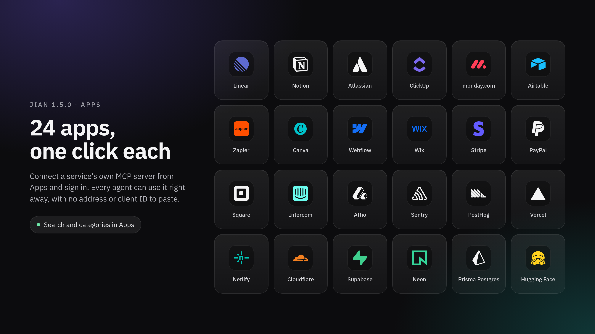

# Changelog

Every release of Jian, newest first.

<!-- Generated from docs/releases by scripts/changelog.mjs. Edit the release note, then run `make changelog`. -->

## 1.9.0 — 2026-11-07

Agents get their own email address, a turn rides out network drops, and long conversations stay light and easy to follow.

### Email

* **An address of the agent's own:** Connect an address on your own domain through Resend or Cloudflare, and the agent reads and answers email there. On Cloudflare, Jian sets up the forwarding Worker and the routing rule itself, and removes them when you disconnect. Mail is taken in only when its sender's domain authenticates it. Auto-replies and mailing lists are ignored, and a stranger waits as a pending contact until you approve them. Replies stay in their thread, and attachments travel both ways.
* **Writing to anyone, with your say:** The agent can email any address. The first email to someone who isn't an approved contact waits for you to read and approve it, and so does one that copies such an address. You see every address it goes to, its files with their sizes, and the subject. After that each of those addresses is a contact, and later emails to them go out without asking. Replies come back to the conversation that wrote.
* **Formatted email, copies and files:** The agent's email goes out formatted, with a plain-text copy for mail clients that show only text. It can copy up to 10 addresses and attach up to 5 files, 16 MB each and 20 MB together. A reply in a correspondent's conversation goes to that person alone.
* **Each correspondent gets their own conversation:** The agent answers people in those conversations and tells you what matters. When a service asks for something only you have, such as a code, a password or a payment, the agent asks you first.
* **Signing up to services:** The agent can sign up to a service with its own address and read the confirmation email or code it gets back. It can also search everything it has sent and received.

### Conversations

* **Subagents at work, one click away:** A badge above the composer lists the subagents that are working, with what each is doing. Click one to follow it in the Inspector, instead of scrolling back to its card. The badge goes away when none are working.
* **Back to the latest message:** When you scroll up, a round button appears over the end of the conversation and takes you back to the last message. A dot on it means something new arrived below.
* **Lighter tool calls:** A turn's tool calls now come as short previews, and a tool's full input and output are fetched only when you open it. A long turn no longer downloads megabytes on every step.
* **The subagent drawer shows the right agent:** Switching tabs in the Inspector could show another subagent's messages, and a finished subagent's tool calls could disappear. Both are fixed. The drawer reads only that subagent's own turn, and its text and header now sit a gutter in from the edge.
* **Inspector tabs:** With many tabs open, the strip scrolls sideways with the mouse wheel, shows no scrollbar, and keeps the open tab in view.

### Model calls

* **A network drop no longer ends the turn:** When a call to the model fails because the network or the provider is down, the agent keeps trying until it gets through. It makes 10 attempts a second apart, then waits 30 seconds, 1, 2 and 4 minutes, and then every 5 minutes for as long as it takes. When the provider says how long to wait, it waits that long. While it waits, the working line says "Reconnecting to the model" with the attempts so far and a countdown, and stopping the run ends the wait.
* **Rate limits wait, refusals don't:** A 429 that is a rate limit, including Gemini's, waits as above. A 429 that is a refusal, such as an exhausted quota or a malformed subscription request, fails at once with the provider's message. Other errors that waiting can't fix, such as a bad key or a request that is too large, also fail at once.
* **Learning stops sooner:** A background look back at a turn makes one round of 10 attempts, then gives up, so it never holds a slot waiting on the network.

### Desktop

* **No more false "gateway offline":** The app checks each gateway on a connection of its own, so a busy conversation no longer makes it think the gateway went away. A check that gets no answer now says "No answer in 8 seconds".

### Chats

* **WhatsApp Business is gone:** The WhatsApp Business (Meta Cloud API) channel is removed. WhatsApp keeps working through the linked app.

### Upgrading

* The desktop app updates itself to this release.
* **Servers:** Recreate the gateway and web containers with the 1.9.0 images, or follow the `latest` tags. Migrations 0097 to 0101 run when the gateway starts.
* **WhatsApp Business channels:** Migration 0098 disconnects every WhatsApp Business channel and discards its stored credentials. Its contacts and conversations stay. Messages still waiting to be sent through one are marked failed. To keep talking to those people, connect WhatsApp through the linked app.
* **Email:** The gateway needs `JIAN_PUBLIC_URL` set to the address the internet reaches it at, so the provider can deliver incoming mail. Then add an Email channel in the agent's settings, under Channels, and pick a provider.
* **Email through Resend:** It takes an API key with full access and an address on a domain verified in Resend, with receiving on and its MX record in place.
* **Email through Cloudflare:** It takes an API token, the account ID, and an address of a zone in that account, with Email Routing enabled and the domain onboarded in Email Sending. The token needs Account › Email Sending: Edit, Account › Workers Scripts: Edit, Zone › Email Routing Rules: Edit, Zone › Zone Settings: Read and Zone › Zone: Read. The address can be at most 90 characters.
* **API:** `GET /v1/profiles/{profileId}/sessions/{sessionId}/timeline` takes `brief=1` for short previews, and `GET /v1/profiles/{profileId}/sessions/{sessionId}/runs/{runId}/steps/{toolCallId}` returns one tool step in full. An Email channel takes `provider: "cloudflare"` with `accountId`, besides `resend`. A run's `progress` can carry `reconnecting`, with the attempts, the next try and the reason, while it waits on the model.

## 1.8.0 — 2026-11-07

Answers flow in as the agent writes them, the chat stops jumping, and the agent's questions in a chat come to you.

### Conversations

* **Answers flow in:** The text of an answer now reaches the panel as the agent writes it, and appears at an even pace. It no longer lands in big chunks or makes words flicker. A long block that arrives at once shows within about half a second.
* **Sending a message doesn't jump:** What you send stays where it is when the gateway stores it, and the agent goes from starting to working on the same line.
* **The end of an answer stays put:** When an answer finishes, the text you were reading becomes the stored message in the same place. A paragraph the agent sends partway through a turn stays on screen until it's saved, instead of vanishing until the turn ends.
* **Tool calls open at once:** A turn's tool calls, and each call's details, open and close with no animation. Their input and output are only built while open, which makes a long conversation much lighter.
* **Older messages load as you scroll:** A conversation opens with its last 40 messages and loads 40 more each time you near the top. Messages far off screen are skipped when drawing, in browsers that support it.
* **Opening a conversation is still:** Nothing animates or types itself out when you open a conversation, including one that's in the middle of an answer.

### Chats

* **The agent asks you, not the contact:** When the agent asks a question in a WhatsApp or Telegram conversation, it waits for you in the panel. The question goes to the chat only if you allowed that chat to approve. The contact's messages join the waiting turn as information, and a question asked in a chat always comes with choices.

### Upgrading

* The desktop app updates itself to this release.
* **Servers:** Recreate the gateway and web containers with the 1.8.0 images, or follow the `latest` tags. There is no migration. A panel and a gateway of different versions still work together, but the smooth text needs both on 1.8.0.
* **API:** `GET /v1/profiles/{profileId}/sessions/{sessionId}/messages` takes an optional `limit` from 1 to 100, and returns 100 without it, as before. `GET /v1/profiles/{profileId}/events/stream?progress=1` adds the run's `progress`, with the text written so far, to each `run.progress` event; streams without `progress=1` get the same events as before. Each paragraph an agent sends partway through a turn also records a `session.message` event.

## 1.7.1 — 2026-11-07

A long conversation stays light in the panel while its agent works.

### Conversations

* **A long conversation at work no longer slows the panel down:** On every step of a turn, the panel downloaded the tools of every turn in the conversation again, over a megabyte on a long one, and redrew every message. It now reads only the turn at work, one read at a time, and redraws a message only when its text changes. This applies to the desktop app and the web panel.

### Upgrading

* The desktop app updates itself to this release.
* **Servers:** Recreate the gateway and web containers with the 1.7.1 images, or follow the `latest` tags. There is no migration.

## 1.7.0 — 2026-11-07

Agents keep long conversations near their model's full window and pay less for them, hand work to subagents and wait for the report, and see the end of long tool output.

### Long conversations

* **You choose when each agent compacts:** Agent settings has a new Compact conversations setting, under Identity. By default an agent summarises a conversation near the end of its model's window, about 83% of what the model can take in after the room it keeps for its answer, or roughly 773,000 tokens on a model with a million. Jian used to stop at 200,000. To pay less per step, pick At a set size and type a number of tokens, 50,000 or more, or choose 200K, 400K or 600K. A size the model can't reach is held to the default.
* **Compaction reads the conversation from the cache:** A summary used to be a separate request that read the conversation again at full price. Now Jian sends the request the conversation just sent, with one more message asking for the summary, so a provider that caches prompts reads everything before it from the cache. On Claude a cached read costs a tenth of a fresh one. The cache lasts an hour for your own conversations on Claude. A conversation you come back to later is summarised in one request without the cache, and one already past the model's window is summarised in parts. The compaction checkpoint records how many input tokens came from the cache.
* **Summaries think less where they can:** On the Claude models that take an effort for a single reply, among them Opus 5 and 5.5 and Sonnet 5.5, a summary is written at low effort. On other models a summary sent from the cache keeps the conversation's effort, since changing it would throw the cache away, and a summary written in parts uses the least effort.
* **A summary keeps people's words and the files being edited:** What people wrote in the summarised turns stays word for word next to the summary, newest first, up to 20,000 tokens, with who wrote it: you in Jian, or a contact or group member by name and channel. Other agents' messages are not kept. A very long message keeps its beginning and its end. The summary itself lists every request you made, quoted briefly, and stays within about 2,500 words. The agent also gets the current contents of the last five files it changed in those turns, up to 5,000 tokens each and 20,000 in all. A bigger file, or one that can't be read, is listed by its path so the agent knows to open it again. Files that look like credentials, such as `.env` files and keys, are never kept. A cut to fit the window never drops the summary.
* **The Context line shows how close compaction is:** Each turn tells the agent how far it is from the point where Jian compacts that conversation, counting the tool definitions too. It used to give a share of the whole window, so on a 1M-token model it read about 20% when a summary was due. The agent's advice on when to compact by itself uses the same point, and so does the context ring.
* **Tool results, memories and skills get their full room:** On Claude these limits were counted a byte a token, about 2.4 times tighter than meant. The 12,000-token limit on a tool result held about 5,000 of Claude's tokens, so the agent read the rest a page at a time, and every page was another step that sent the whole conversation again. They are now counted in Claude's own tokens. Other providers count as before.

### Subagents

* **Your agent hands work off when it pays:** It can start a subagent without loading anything first, and it is told when that is worth doing: a wide search, a long log or a test run whose detail would only fill the conversation, pieces that can run side by side, or a second look at its own work. It keeps a single lookup or a few files for itself. A brief is all it has to write.
* **It waits for the report:** By default the agent gets the subagent's report back in the same turn. Several subagents started together run at the same time. If one takes longer than 15 minutes, or can't start within a minute, the agent stops waiting and the report arrives later, in the turn still going or as a new one. A long report is kept whole for the agent to read.
* **A report is the subagent's account:** It reaches the agent marked as something to check before relying on it, and it is screened for instructions aimed at the agent, like a web page.
* **Only you answer the agent's questions:** A question your agent asks you is answered only by you, or by the person a channel conversation is with. A subagent's report, a nudge to continue the conversation's objective, a schedule or another agent's message used to count as your answer. They now reach the agent as information and the question stays open.

### Tool output

* **The end of long output survives:** When a command's output, a file, a search or a connected service's text is too long to show in full, the agent sees its beginning and its end instead of only the beginning, with a line saying how long it really was and where the full copy is. The error at the bottom of a failed build is no longer cut off. Commands keep the first and last 30,000 characters of their output on the gateway, and the first and last 200,000 on a connected machine.
* **One step's results share a limit:** When several large results come back in one step, they are shortened together, the biggest first, so a burst of parallel reads can't fill the conversation at once. The full output stays available, and a page the agent is reading through is never shortened.

### Fixes

* **Tool answers come through on Claude:** Since 1.6.2, on Claude 4.5 and newer, a call that made other tools available sent the agent only those tools' names in place of its result. A result too long to keep whole lost its preview and the way to read the rest, and the first call into a tool group or the browser could come back empty. Every tool's result now reaches the agent as it was.
* **Long turns on a server:** A run that went past 11 minutes was marked failed in the job queue while it kept going, so a worker could end up running more turns at once than it should. Runs now hold their place for up to 6 hours and keep showing they are alive, so a worker that dies is still noticed within a couple of minutes.

### Upgrading

* The desktop app updates itself to this release.
* **Servers:** Recreate the gateway and web containers with the 1.7.0 images, or follow the `latest` tags. There is no migration. The job queues pick up their new settings when the gateway starts.
* **Machines with Jian Remote:** Update them from Machines to keep the end of long remote output. An older Jian Remote still works and keeps only the start.
* **Compaction point:** Every agent starts on the new default, near the end of its model's window. If you'd rather keep 200,000, set At a set size to 200K in each agent's settings.
* **API:** An agent's `contextPolicy` takes `compactAt`, `"auto"` or a number of tokens from 50,000, and is replaced whole on `PATCH /v1/profiles/{profileId}`, so send it back with every field. `spawn_subagent` needs only `brief` and takes `wait` (default `true`).

## 1.6.2 — 2026-11-07

Loading tools on Claude works again, and a refusal of the new form no longer fails a run.

### Claude

* **Loading tools works again:** Since 1.6.1, a run on Claude failed with "Tool definitions/code execution functions cannot be mixed with other content" as soon as the agent loaded a tool it hadn't loaded before. A load now answers with the loaded tools alone, the form Anthropic accepts, and the cache still holds.
* **A refusal goes the old way instead of failing:** If Anthropic refuses the new form in any words, Jian sends that step again the old way, and keeps doing so for that model only if the old way works. Before, it fell back only for refusals it recognised, so this one failed the run.

### Upgrading

* The desktop app updates itself to this release.
* **Servers:** Recreate the gateway and web containers with the 1.6.2 images, or follow the `latest` tags. There is no migration.

## 1.6.1 — 2026-11-07

Loading tools on Claude no longer makes it read the whole conversation again, and the panel catches up after a gateway update and shows an agent's questions as written.

### Claude

* **Loading tools keeps the cache:** Each time an agent loaded tools or an app's tools, Claude read the whole conversation again without its cache, about 630,000 tokens in one long turn. Loaded tools are now added to the conversation, and the tool list Claude caches stays the same for the rest of the turn. This applies to Claude 4.5 and newer. On Opus 4.8 and newer, Sonnet 5.5, Fable 5 and Mythos 5 it also stays the same from one turn to the next; on the other models, the first turn after a load reads less from the cache. If Anthropic refuses this new form for a model, Jian goes back to the old one for that model.

### The panel

* **Release notes catch up after a gateway update:** A panel left open while its server gateway was updated, in the desktop app or on the web, kept saying "1 release behind" and showed the old version's notes until you reloaded it. They now refresh when the panel reconnects.
* **Questions read as written:** A question from an agent showed as one run-together paragraph, asterisks included. It now shows its lists, bold text and line breaks, like the agent's replies.

### Upgrading

* The desktop app updates itself to this release.
* **Servers:** Recreate the gateway and web containers with the 1.6.1 images, or follow the `latest` tags. There is no migration.

## 1.6.0 — 2026-11-06

Pair a phone with your gateway by scanning a QR code, and get a push when an agent replies or needs you.

### Phones

* **Pair a phone:** Settings → Mobile shows a QR code with your gateway's address and a one-time pairing code that works for 5 minutes. Scanning it gives the phone a token of its own, so you never copy your owner credentials onto it. The Jian app for iOS and Android isn't released yet, but the gateway side is ready for it.
* **See and revoke your phones:** The page lists each paired phone with its platform and when it was last seen. Revoke asks first, and a revoked phone loses access at once.
* **Needs `JIAN_PUBLIC_URL`:** The QR code carries your gateway's address, so pairing needs `JIAN_PUBLIC_URL` set. Without it, the page tells you to set it.
* **Not on the desktop app's own gateway:** Mobile isn't offered there. It appears when the desktop app is connected to a server gateway.
* **No rate limit for paired phones:** They are treated like you. Pairing attempts are limited to 10 a minute.
* **Retries don't repeat a message:** A retried message is no longer added twice while an agent is working or waiting for your answer, for example when a phone retries after a lost reply.

### Push notifications

* **When it sends:** Each paired phone with notifications on gets a push when an agent replies in a panel chat, asks for approval or asks a question, or when a run stops on an error. The title is the agent's name, pushes are grouped per conversation, and the app icon's badge shows how many panel chats are waiting for your answer.
* **Show previews:** Turn it off for a phone and the text is replaced with "replied", "needs your approval", "asked you something" or "stopped on an error".
* **Previews pass through Expo:** Unlike browser notifications, pushes to a phone go through Expo's push service and are not end-to-end encrypted, so a preview passes through Expo, Apple and Google unless you turn Show previews off for that phone.
* **No push where you are looking:** A phone that has that conversation open gets nothing, and no phone gets one about a chat you are reading in the panel. Jian stops sending to a phone that uninstalled the app.

### Conversations

* **Compaction waits until a conversation nears its limit:** Claude's prompts were counted at more than twice their real size, so long turns were compacted early, the summary often failed, and every attempt read the whole prompt again without the cache. Jian now goes by the size the provider reports, and doesn't attempt a summary that couldn't shrink the conversation.

### Upgrading

* The desktop app updates itself to this release.
* **Servers:** Recreate the gateway and web containers with the 1.6.0 images, or follow the `latest` tags. The gateway applies the new migrations, `0095_devices.sql` and `0096_message-request-key.sql`, when it starts.
* **Pairing:** Set `JIAN_PUBLIC_URL` in the gateway's environment to the address your phone reaches it at.
* **API:** New routes `POST /v1/devices/pairings`, `POST /v1/devices/pair` (public), `GET /v1/devices`, `PATCH /v1/devices/{deviceId}`, `DELETE /v1/devices/{deviceId}`, `GET /v1/devices/self`, `PUT /v1/devices/self/push`, `PUT /v1/devices/self/focus` and `DELETE /v1/devices/self`. A device token (`Authorization: Bearer jdev_…`) opens the API with the owner's access.

## 1.5.2 — 2026-11-06

Compaction stops burning your quota when it fails, Apps gets 18 more services and several accounts per app, Atlassian moves to v2 with Bitbucket, and Jian starts sending an anonymous daily report you can turn off.

### Compacting a conversation

* **A failed summary no longer eats your quota:** The summary was cut off at 2,048 tokens because the model spent them thinking first, so compaction failed with "The summary was cut off at its limit". Once a conversation was past its window, it then tried again on every step, each time sending up to the whole conversation without the cache. One long conversation sent 14 million tokens without the cache this way in under half an hour. Summaries now think as little as the model allows and can write up to 8,192 tokens, and a long conversation is summarized in pieces of up to 120K.
* **It stops retrying:** After a failed summary, your agent tries again only once the conversation has grown by a quarter or no longer fits, and never more than twice in a row. Meanwhile it drops the oldest turns and tool results once, down to 60% of the point where compaction starts, so the steps after that read from the cache again.
* **Compact now answers right away:** Your agent shows as starting the moment you click, instead of nothing happening until the next refresh. Clicking again while a turn runs compacts once, where each click used to reach your agent as the words "/compact".

### Models

* **Low and Medium mean less thinking on Claude:** On Claude 4.6 and newer, including Opus 5.5, the effort you pick now reaches the model. Before, Low and Medium thought as much as High.
* **Cache writes in the context ring:** The ring now also shows how many tokens were written to the provider's cache, next to how many were read from it.

### Apps

* **Connected apps come first:** An app moves to the top of the list as soon as you connect it.
* **Several accounts per app:** Every connected app now has Configure, with its accounts, Sign in and Remove for each, and Connect another account. Each account is named after who signed in, like `linear_kai`, so your agents can tell them apart. An app that can't say who signed in numbers them instead (`linear_2`). Apps you already connected get their new names the next time you open Apps. The service signs in whichever account your browser is logged into, so switch accounts there first or use a private window.
* **Atlassian adds Bitbucket and Compass:** Atlassian now connects to its v2 server, with Bitbucket and Compass next to Jira and Confluence. Bitbucket shows up only for workspaces linked to an Atlassian organization. An Atlassian you already connected keeps working on v1; remove it and connect again to get the rest.
* **18 more apps:** Trello, Todoist, Make, Calendly, Cal.com, Dropbox, Miro, Sanity, Mercado Pago, GitLab, AWS, Railway, Hostinger, Expo, Resend, Postman, Buildkite and Mixpanel. Each is the service's own MCP server and connects with one click.
* **Why Google isn't there:** Google Workspace, Asana, Box, HubSpot, Slack, Figma and Shopify only accept clients registered with them beforehand, so they can't connect with one click. You can still add them under MCP servers with an OAuth client of your own.

### Anonymous usage data

* **What it is:** Once a day your gateway sends a report of counts to Jian's PostHog project in the EU, under an ID drawn at random for your installation. It covers the version and system, how many agents and runs, which models, Jian tools and apps were used, how often compaction ran or failed, and what kind of error runs failed with.
* **What it never sends:** Messages, names of agents, conversations or servers, addresses, files, credentials, error messages or the IDs of models you host yourself.
* **Turning it off:** It is on by default. Turn it off under Settings → General → Privacy. Development builds never send it.

### Upgrading

* The desktop app updates itself to this release.
* **Servers:** Recreate the gateway and web containers with the 1.5.2 images, or follow the `latest` tags. There is no migration.
* **Turning off anonymous usage data for good:** Set `JIAN_TELEMETRY=off` or `DO_NOT_TRACK=1` in the gateway's environment. `compose.yaml` passes both through from `.env`. With either set, Settings shows it as off and can't turn it on.
* **Renamed app accounts:** If an agent's instructions or a schedule name a connected app's server, such as `linear`, check them after the rename.
* **API:** `GET /v1/settings` now includes `telemetry`, and `PUT /v1/settings` accepts `telemetry: true | false`. Run usage now includes `cacheWriteTokens`.

## 1.5.1 — 2026-11-06

Compaction runs on the conversation's own model and says why when it fails, a full window gets freed instead of stopping your agent, and conversations spend far fewer tokens.

### Compacting a conversation

* **Out of the chat:** Compact now and a typed `/compact` no longer leave a `/compact` message in the conversation. You still get your agent's one line on how it went. The `/compact` messages already in your conversations stay where they are.
* **It says why it failed:** When a summary fails, your agent now tells you the real reason, such as the provider's quota running out. Before, any failure came back as "nothing old enough to compact", even when there was plenty.
* **Your conversation's model does the summary:** Compaction now uses the model the conversation is on. Context compaction is gone from Capabilities, and a model you had picked there is ignored. Switching a conversation away from a provider whose quota ran out now takes compaction with it.
* **Earlier and on its own:** Older turns become a summary once the conversation passes 80% of the window or 200,000 tokens, whichever comes first, and right at the start of a turn that is already past that. It used to wait for 85%. Recent work and your latest request stay whole.
* **A full window gets freed:** Moving to a model with a smaller window could leave your agent's instructions and tools alone too big to fit, and the turn failed. Your agent now lets go of the tool groups and MCP tools it had loaded, and if that is still not enough it keeps only what it needs to load them again. It reports an error only when its instructions alone don't fit.

### The context ring

* **100% means nearly full:** The ring kept a quarter of the window aside for the answer, so on a 500K model it showed 100% at 375K, with a quarter of the window still free. That reserve now stops at 64K: 436K for a 500K window, 936K for a 1M one.

### Spending fewer tokens

* **Grok reuses its cache:** Every request to xAI now carries the conversation's ID, which xAI uses to send it back to the server that already cached it. Before, almost none of a Grok conversation came from the cache.
* **Look backs read only their own turn:** The review your agent writes after a turn used to read every review before it, at up to a million tokens each. Each one now reads only its own turn.
* **Smaller pieces in every step:** A tool result keeps up to 12K tokens in the conversation, loaded skills up to 16K and the memories in the turn context up to 8K. Anything past that is stored and your agent reads it back in pages, so nothing is lost. These limits matter most on 1M models, where they used to be much higher.

### Upgrading

* The desktop app updates itself to this release.
* **Servers:** Recreate the gateway and web containers with the 1.5.1 images, or follow the `latest` tags. There is no migration.
* **API:** `compaction` in the model defaults is still accepted, so older clients can save, but it is ignored.

## 1.5.0 — 2026-11-05

Apps gets a search, categories and two dozen services you connect in one click, the desktop browser works for agents on a server gateway, and the Inspector opens when your agent asks.

### Apps



* **Connect services in one click:** Linear, Notion, Atlassian (Jira and Confluence), ClickUp, monday.com, Airtable, Zapier, Canva, Webflow, Wix, Stripe, PayPal, Square, Intercom, Attio, Sentry, PostHog, Vercel, Netlify, Cloudflare, Supabase, Neon, Prisma Postgres and Hugging Face now each have a card. Connect adds the service's own MCP server and opens its sign-in, with no address or client ID to paste. Every agent can use it after that.
* **What a connected card shows:** Whether the service answers, checked again when you come back from the sign-in tab, a Sign in button when it asks for one, and Remove, which asks before deleting it. The card is the whole app: it stays off the MCP servers page, which keeps the servers you add by hand.
* **Nothing you added gets replaced:** A server you already added by hand at the same address shows up as that app, and moves from MCP servers to its card. If its name is taken, Connect saves the new one under another name.
* **Search and categories:** A search box looks through each app's name, category and description, and a category list next to it narrows the cards.

### Remote machines and the desktop browser

* **The desktop browser works with a server gateway:** An agent on a server gateway that tried to use the browser beside the conversation in your desktop app failed every time with "Mark did not answer". The app did the work, but its answer never reached the gateway. Now it does, screenshots included.
* **Updates refuse an old Node.js:** Updating Jian Remote on a machine with a Node.js older than 24 used to install the new release anyway, and then it broke on start. The update now stops before touching anything and tells you what to install.

### The panel

* **The Inspector opens when your agent asks:** `open_in_inspector` said it had worked, but the Inspector never opened and you had to open the pull request yourself. It opens now. The same fix stops the open conversation from reloading every time something happens in another one.
* **GitHub's real reason:** When GitHub refuses a merge or an Update branch, for example because of a ruleset, the message now says what GitHub said, instead of "Something changed, or the session is busy".
* **No sideways scrolling in settings:** A long name in a settings list, such as a schedule's, made the sidebar scroll sideways. Long names are now cut off with an ellipsis.

### Upgrading

* The desktop app updates itself to this release. The desktop browser fix is in the app, so it needs the new app.
* **Servers:** Recreate the gateway and web containers with the 1.5.0 images, or follow the `latest` tags. There is no migration.
* **Machines with Jian Remote:** Update them from Machines. A machine needs Node.js 24 or later. If one runs an older Node.js, install Node.js 24 on it, then run `npm install -g @jian-ai/remote-control@1.5.0 && jian-remote reinstall` there.

## 1.4.2 — 2026-11-05

Your agent can look at a big picture without its run failing on the context budget, Files changed stays under every run, and the viewer shows PDFs on the desktop app and fits tall pictures.

### Your agent's context

* **Pictures no longer fill the context:** When your agent looked at a picture or a PDF with `analyze_media`, the gateway counted its data as text, so one large picture could count as hundreds of thousands of tokens. The run then stopped with Context budget exceeded, though the request it would have sent was far smaller. A picture inside a tool result now costs what an attached picture costs.
* **Long runs make room instead of failing:** If a single run outgrows the context, the gateway now swaps the oldest tool results of that run for a short note, oldest first, until it fits. Your agent keeps the record of what it called, the latest step's results are never removed, and it can read any removed result again with `read_artifact`.

### Conversations

* **Files changed stays:** The list of files a run changed used to vanish as soon as you sent another message. Every finished run now keeps it under its last message, and a file in it opens that run's diff.
* **Merges show up right away:** After you merge a pull request from the panel, its conversation hears about it at the next check, instead of showing Watching next to Merged for up to a minute.

### The viewer

* **PDFs on the desktop app:** A PDF opened blank in the desktop app. It now opens in Chromium's PDF reader, which scrolls and zooms on its own.
* **Tall pictures fit:** A long screenshot opened at full size and cut off, with no way to scroll to the rest. It now fits the screen first. Double-click, pinch or Ctrl and scroll to zoom in, then scroll to move around.
* **Clear of the window buttons:** On the desktop app the viewer starts below the title bar, so the file name no longer sits under the Mac's traffic lights, and the close button stays clear of the window buttons on Windows and Linux.

### Upgrading

* The desktop app updates itself to this release.
* **Servers:** Recreate the gateway and web containers with the 1.4.2 images, or follow the `latest` tags. There is no migration.

## 1.4.1 — 2026-11-05

This computer's gateway no longer freezes after a pull request your agent opened gets a review, and files you attach in the composer stay put when you switch conversations.

### This computer's gateway

* **No more freezing after a review:** When a pull request your agent opened got a review or a comment, the desktop app's gateway could stop answering for good. The app showed No answer in 8 seconds, merges ended in a timeout and pictures wouldn't send. Restarting didn't help, because it froze again the next time it looked at the pull request, about a minute later. It now reads the change and tells your agent about it.
* **If something like it comes back:** Instead of freezing, the gateway now refuses the step that would freeze it, keeps answering, and writes where it came from to `local-gateway.log` in the app's log folder (`~/Library/Logs/Jian` on a Mac). That line is what to send when you report it.

### The composer

* **Attachments stay with their conversation:** Files you attach stay in the composer when you go to another conversation and come back, like the text already did. One that finishes uploading while you're elsewhere is ready when you return. Closing the app still clears them; the text is kept.

### Upgrading

* The desktop app updates itself to this release. Once it does, a gateway that was frozen this way starts working again on its own.
* **Servers:** Recreate the gateway and web containers with the 1.4.1 images, or follow the `latest` tags. A gateway on a server didn't freeze like this, but the same mistake could hold up a pull request's conversation that came from a channel. There is no migration.

## 1.4.0 — 2026-11-05

Each conversation can work in a git worktree of its own, so agents sharing a repository stop stepping on each other, and on a machine your agent edits files with the same tools it uses on the gateway, with diffs and Changes.

### Worktrees

* **A checkout per conversation:** Your agent can work in a git worktree, a separate folder with its own branch `jian/<name>` made from the branch you have checked out. What it does there stays out of your folder until it's merged.
* **When it makes one:** At the start of each turn your agent sees who else works in each folder. If another agent or conversation is there, it makes a worktree before its first edit. If only your uncommitted changes are there, it asks before touching the folder. You can also just ask for one.
* **Writes stay in the worktree:** While a worktree exists, your agent's file tools refuse to write in the folder it came from, and its commands start in the worktree.
* **The badge:** A worktree badge sits to the left of the pull request badge. It shows how far the worktree is ahead or behind its base and how many files are uncommitted, with Merge into, Update from, Open pull request and Discard. The first three ask your agent to do it. Discard asks you to confirm, says what will be lost, and waits until the agent has finished.
* **Merging:** A merge goes into the folder the worktree came from, then removes the worktree and its branch. If a hook stops the merge or it takes too long, the merge is undone and your agent is told why. A branch with commits the base doesn't have is kept when a worktree is removed, unless you asked to throw the work away.
* **Changes in the Inspector:** Changes shows a worktree's changes against its base, without mixing in other worktrees or your folder.
* **Subagents:** A subagent gets its own worktree, made from the conversation's one, and merges back into it.
* **Ask first:** Under Ask first, creating, updating, merging and removing a worktree wait for your approval, like commands do.

### Working on machines

* **File tools on the machine:** In a conversation that works on a machine, This computer included, your agent reads, writes, edits, lists, finds and searches files there with the same tools it uses on the gateway. Its edits show up as diffs in the turn, and worktrees on the machine get the same write protection.
* **Changes on machines:** Changes now opens for a conversation that works on a machine, for its worktrees and for the project's clone there. It used to say changes on remote machines weren't available yet.
* **Jian Remote's own data:** Your agent's file tools can't reach the folder where Jian Remote keeps its credentials.
* **Copying files:** Sending and fetching files on a machine works up to 300,000 bytes. Before, sending anything over about 6 KB failed, and a fetched file that came back cut short was saved as if it were whole.
* **This computer:** The desktop app shows Agent working with files while your agent works on files on this computer.

### The Inspector

* Pull request actions are aligned to the left.

### Upgrading

* **Migration 0094 runs at startup.** It adds the table that records each conversation's worktrees.
* **Update your servers.** Recreate the gateway and web containers with the 1.4.0 images, or follow the `latest` tags. The desktop app on 1.4 works only with gateways on 1.4 and shows the mismatch on any other. This computer's gateway moves with the app.
* **Update each machine's worker.** A 1.3 worker shows Update needed in Machines and gets no work from a 1.4 gateway until it's updated. Update in Machines does it for a worker installed with npm. On any other, run `jian-remote update` on that computer. File tools and Changes on a machine need its worker on 1.4.
* The desktop app updates itself to this release.

## 1.3.1 — 2026-11-04

You can stop the agent from the composer, conversations with a remote gateway keep up while the agent works, and the agent can create GitHub issues and push release tags through the integration.

### Staying connected

* When the gateway's database notification connection drops, it reconnects automatically. Event streams subscribe before reading, so changes committed during a read arrive without waiting for the next 25-second heartbeat.
* While the agent works, an open conversation no longer waits on the event stream alone. After a few seconds without news it reads the conversation again, and it checks less often the longer the silence lasts. A turn on a remote gateway no longer sits frozen until it ends.

### The conversation

* While the agent works, the send button turns into a stop button whenever the message box is empty. Anything you write still reaches the agent in the same turn.
* The agent shows up as Starting the moment you send a message. Before, the message could sit alone until the gateway answered.
* When you send a message while the agent is working, the work it did before your message stays above it, and the work after goes below. This used to sort itself out only when the turn ended.

### GitHub in the Inspector

* **Mark drafts ready:** Mark an open draft pull request ready for review from the Inspector. Jian checks that it is still open and its head branch has not changed since it was shown.
* **Branch updates:** Updating a pull request branch no longer makes it look merged. The Inspector reloads its details after GitHub accepts the update.
* Pull request details start loading when you hover over or focus a link, so the Inspector can open them sooner.

### The agent and GitHub

* Creating an issue through the GitHub integration no longer fails with "failed to resolve parent issue". The agent filled in a parent issue number on its own, usually 1, and GitHub refused the whole issue wherever #1 did not exist. Jian now leaves the parent fields out when the agent creates an issue. Making an issue a sub-issue of another is still possible, as a separate step.
* The agent can push tags through the GitHub integration, so a release script that tags a version, such as `make release`, can finish from a conversation. Annotated tags keep their message, and the agent cannot move or force-push a tag GitHub already has.

### The Inspector and chat

* The Inspector waits for the panel's first size measurement before choosing whether to fill the conversation area. This prevents an initial zero-width reading from forcing the wrong layout.
* Reload Chat confirms when it succeeds and reports an error when the reload fails.
* A subagent's reply in the Inspector reads as one message, as it does in the conversation, instead of one message per paragraph.
* Calls to MCP server tools are titled with the server and the tool, such as `github · issue_write`, and show their input and output as JSON you can copy and wrap, instead of a list of labelled fields.
* Every built-in tool in a turn's trace has a readable name now. Tools like SSH keys, machines, objectives and X posts used to show their function names.

### Upgrading

* Recreate the gateway and web containers with the 1.3.1 images, or follow the `latest` tags. This release has no database migrations.
* The desktop app updates itself to this release.

## 1.3.0 — 2026-11-03

Turns cost less, because your agent keeps the skills and tools it loaded and providers read the conversation back from their cache. Agents follow a repository's AGENTS.md and skills, and the gateway watches the pull requests they open and tells them when something changes. Servers, machine workers and the app all move to 1.3 together.

### What each turn costs

* **Cheaper turns:** The instructions and the conversation so far now stay the same from one turn to the next, so providers that cache, like Anthropic and OpenAI, read them back at a fraction of the price. The time, the memories that may help and how full the context is come with each turn, after the conversation.
* **Lighter history:** Tool results from your last two turns stay whole. Older ones are cut to a short excerpt, and your agent reads one back in full when it needs it.
* **Skills load once:** A skill your agent loads stays in its instructions for the rest of the conversation, so it won't load it again. Tool groups and MCP tools it loads stay loaded too. Each compaction lets go of whatever wasn't used since the one before.
* **Cache share:** It's in an agent's Activity and shows how much of what it sends is read from the cache.

### Projects

* **Your repository's instructions:** In a chat that works in folders or repositories, your agent follows each one's `AGENTS.md`, or its `CLAUDE.md` when there's no `AGENTS.md`. They rank below your own instructions and can't allow anything you wouldn't.
* **Your repository's skills:** Skills in `.agents/skills` and `.claude/skills` show up beside your agent's own.
* **Nested instructions:** `AGENTS.md` and `CLAUDE.md` files in subfolders are listed, and your agent reads them when it works there.
* **Kept current:** Changes are picked up within a minute on the gateway and within five minutes on a machine. On a Windows machine your agent reads the files itself.
* **Subagents too:** A subagent gets the instructions and skills of the conversation that started it.

### Pull requests

* **The badge counts what your agent opened:** It lists the pull requests your agent or its subagents created. One they only linked no longer shows up.
* **Watched for you:** The gateway watches each pull request your agent opens until it's merged or closed. A new review or comment, a failed check, checks passing after a failure, a conflict, or commits from someone else reach your agent as one note, in the background. The note stays out of the chat, and you see what your agent does about it. The badge says which ones are watched, and why one can't be.
* **Listeners are gone:** Watchers, listeners and subscriptions were removed, along with everything they kept.
* **A smaller pull request panel:** It has flat tabs, a file filter and line wrapping.

### Conversations

* **The whole history:** Long conversations page their messages and tool activity and keep everything in order. A read that came back incomplete says so.
* **Changes in the Inspector:** A project chat shows what changed in its checkout. A chat without one opens the changes its agent saved.
* **Flat diffs:** They have one column of line numbers, bars for unchanged lines, arrows that bring hidden lines in, and marks on what changed inside a line. Check a file as reviewed to fold it away. The bar past the first or last change that had nothing to show is gone.
* **Tool calls:** Each one waits for the line before it, and its details open only when there's something in them. What your agent says between tools reads as one answer.

### Settings

* **Apps and MCP servers:** Integrations is now two pages. Apps shows GitHub and X as cards, each with its state and a Connect or Configure button. MCP servers lists your servers as before. Old Integrations links open Apps.

### Staying connected

* **Lighter event streams:** Opening the panel no longer downloads the whole event history, which on the desktop could make a gateway look offline.
* **Why a gateway is away:** The status bar's list and the gateway's settings say why, and Reconnect clears stuck connections first. A Reload chat that fails says so.
* **Older gateways:** A gateway too old for something says so, where it used to answer Not Found.
* **Small fixes in the desktop app:** The Close Inspector tip opens only under the pointer, and a check cut short by Reconnect no longer hides why a gateway is away.

### What agents know

* **Updated built-in skills:** They cover Apps and MCP servers, the pull request watch, project instructions and skills, and how the context works now.

### Upgrading

* **Migrations 0089 to 0093 run at startup.** They order messages, remove listeners and delete their data for good, and add pull request watchers, what each conversation keeps loaded, and what each workspace was last read as.
* **Update your servers.** Recreate the gateway and web containers with the 1.3.0 images, or follow the `latest` tags. The desktop app on 1.3 works only with gateways on 1.3 and shows the mismatch on any other. This computer's gateway moves with the app.
* **Update each machine's worker.** A 1.2 worker shows Update needed in Machines and gets no work from a 1.3 gateway until it's updated. Update in Machines does it for a worker installed with npm. On any other, run `jian-remote update` on that computer.
* The desktop app updates itself to this release.
* **If you relied on listeners,** there's nothing to set up in their place. Pull requests your agent opens from now on are watched automatically; ones it opened before aren't.
* **The first turn of each existing conversation costs the full price once,** because the prompt has a new layout. The cache applies from the next turn.

## 1.2.2 — 2026-11-01

Your agents can post on X from your own accounts and now share one set of files, on the desktop your own home. The desktop app stops losing replies from a remote gateway, and it reconnects by itself. Read the upgrade steps, because what agents can reach has changed.

### Files and what agents can reach

* **Agents share one set of files:** Every agent on a gateway now works in the same place. Memories, conversations, skills and browser logins stay per agent, but one agent can read and change what another left behind.
* **On the desktop, your home is their home:** On the app's own gateway, agents start in your real home folder and can open anything your user can, except Jian's own data. Your Git and SSH setup works for them as it does for you, and Jian writes nothing to `~/.ssh` or `~/.gitconfig`. A repository cloned with no folder chosen goes in `~/Jian`.
* **On a server, one shared folder:** Agents still can't reach the gateway's own files or process.
* **This computer is always available:** The switch that let agents use the computer running the desktop app is gone, from Machines, the tray and the project chooser. While the app is open and connected to a server gateway, that gateway's agents can use this computer. To stop that, remove the gateway from the app or close it.

### X

* **Connect your accounts:** Settings → Integrations has X now, using your own X developer app. Connect as many accounts as you like, and every agent can use them. It needs `JIAN_PUBLIC_URL`, or the desktop app's own gateway.
* **Nearly everything X's API allows:** Agents can post, reply, write threads and upload media. They can also read mentions, search, follow, handle lists, send direct messages and more. Each conversation's protection still applies, so on Ask first a post waits for your approval.
* **It spends your credits:** Almost every call costs your app's X credits, and a post with a link costs far more than one without. Subagents don't get these tools.

### Staying connected

* **Replies arrive from a remote gateway:** Switching agents or gateways in the desktop app left connections open that nobody read. Over HTTP/2, enough of them froze everything on that connection, so replies stopped and the gateway looked offline. The app now closes them.
* **Reconnects by itself:** A dropped event stream comes back within seconds, and at once when the gateway answers again. A stream silent for a minute is treated as dead and reopened. One failed check no longer marks a gateway as offline.
* **Two new commands:** Reconnect to gateway reads everything again. Reload chat reads only the open conversation. A gateway that isn't answering also gets a reconnect button in the status bar's list.
* **Catching up:** A stream that fell behind now gets all its events at once, where it used to get a hundred at a time.

### Overlays

* **Wider, with actions that float:** Forms and pages have more room. The close button and the action buttons stay in place as you scroll, lined up with the content, and what scrolls fades out before it reaches them.
* **API Server dialogs:** A long webhook address no longer makes them scroll sideways. It's cut off to fit, and Copy still gives you all of it.
* **Notices over the browser:** A toast now shows above the page in the desktop browser. The page turns into a still picture until the toast goes.
* **Clearer errors:** Messages from the desktop app no longer start with `Error invoking remote method`.

### The panel

* **Subscription limits:** The status bar shows a small bar for each subscription, and clicking it opens each window and when it resets. Claude's limits come only from its answers, so Claude appears after a run on it.
* **Questions keep their look:** Once answered, the options stay as they were and stop responding. The ones you didn't pick fade, and yours gets a green check.
* **Chats in folders:** The open chat always shows its status dot.
* **Remote Gateway:** The project and place choosers say Remote Gateway where they said Cloud, and every remote machine has the cloud mark.
* **Menus and sidebar:** Model, effort and protection menus open to the right when there's room. The sidebar can't get narrower than its default width.
* **Integrations you can't use are hidden:** X and GitHub only appear when this gateway can actually offer them.

### MCP servers

* **Test says why:** When a command doesn't answer, the error now includes the last thing it said, with secrets removed.
* **More time to start:** Test gives a command 60 seconds, so a first `npx` install can finish.

### What agents know

* **Updated built-in skills:** Agents now know about https://usejian.app, the desktop app and the current screens. There are new skills for X and for approvals. Three rarely used Ponytail skills are gone, and `ponytail-audit` is now part of `ponytail-review`.

### Machines on Linux

* **`jian-remote` on systemd:** The service file had a setting systemd refused. Restart reported success anyway, and status showed a broken worker version. All three are fixed.

### Upgrading

* Recreate the gateway and web containers with the 1.2.2 images, or follow the `latest` tags. Migration 0088 runs at startup and adds the tables for X.
* The desktop app updates itself to this release.
* **On a server, anything kept in an agent's old home stops applying:** That covers `.gitconfig`, `.ssh/config`, SSH keys you placed by hand, `known_hosts` entries, CLI logins such as `.config/*` and `.npmrc`, and tools in `.local/bin` and `go/bin`. The old folders stay where they are, as `<JIAN_WORKSPACES>/<agent id>`. Move what you need up to `<JIAN_WORKSPACES>`, or log in and install again. Keys you manage under Settings → SSH keys carry over.
* **On the desktop,** commands now use your real home, so your own Git, SSH and CLI setup applies in place of the agents' old folders. Earlier work stays reachable in the app's data. A chat you had already started on a project keeps using its earlier checkout.
* **If an agent talks to contacts on Auto, check what it can now reach:** On a server it can read every agent's files, and on Auto it only stops for what could destroy something for good or leak a credential.
* **To fix the service on Linux,** update each machine's worker with Update in Machines, or run `jian-remote update` on that computer. 1.2.0 and 1.2.1 workers keep working until then.
* **To use X,** add the callback address shown in its overlay to your app in X's Developer Console, exactly as written.

## 1.2.1 — 2026-10-31

The status bar tells you about a new release as soon as the app finds one, chats with no project get their own folder in Recent, and the API Server dialog stops scrolling sideways.

### Updates

* **A button in the status bar:** It shows as soon as the app finds a release: Update available, then Downloading update, then Update ready. No popup. Before, you heard nothing until the download had finished. If a download fails, the button goes back to Update available, and clicking it shows what went wrong.
* **It looks more often:** The app checks every hour, where it was every six, and again when your computer wakes up.

### Recent

* **A folder for chats with no project:** They now live in a folder called No project, sorted by date with the other folders. A chat whose project was deleted goes there too.
* **Chats in a folder use the whole row:** The line down the side is gone. A chat's name still lines up with its folder's, and in the space to its left a dot shows how the chat stands while you point at it: green when the agent is working, the accent color when unread, grey otherwise.
* **The plus button on a folder:** It shows when you point at the folder and no longer stays there after you click it.

### The panel

* **API Server dialogs:** A long webhook address stretched the dialog and made it scroll sideways, pushing the close button out of place. The address now gets cut off to fit, and Copy still gives you all of it.
* **Objective in API Server conversations:** It moved to the bottom corner, where it no longer collides with the Inspector's button.
* **Release notes:** The close button stays in its corner as you scroll, and it sits as far from the edges as Got it does. A release's date is now the right day, with no time beside it. West of Greenwich it showed the evening before.

### Upgrading

* From 1.2.0, recreate the gateway and web containers with the 1.2.1 images, or follow the `latest` tags. No migration runs, and nothing changes for a machine's worker.
* The desktop app updates itself to this release.

## 1.2.0 — 2026-10-31

The desktop app has a browser beside each conversation that you and your agent can both use, a new chat starts by choosing what it works on, and an agent's settings and schedules now open over the chat. Servers, machine workers and the app all need to move to 1.2 together.

### The browser

* **A browser beside each conversation:** The desktop app now has a browser in the Inspector. Each conversation has its own tabs and can't reach another's, and logins are kept per agent.
* **Your agent can use it:** It opens pages, clicks and types with its own pointer, in the page you're watching or off screen when you're somewhere else.
* **On a server gateway too:** An agent on a server drives that same browser through your desktop app, but only while you have the conversation on screen and your last message came from the app. The web panel, channels and subagents never get it.
* **Agents can study any site:** They get a screenshot, the DOM, computed styles and the resources the page loaded, on a server or on the desktop. A server uses its own Chromium for this when you aren't watching.
* **Tabs, favorites and recents:** A new tab offers search, favorites and recents, per agent. The browser's menu takes screenshots, does a hard reload and clears history, cookies or cache, asking first. On macOS you can import cookies from your everyday browser.

### The Inspector

* **It opens empty:** It shows what it can open, with a plus button beside its tabs. Closing it doesn't lose them, and it can take the chat's whole area. Cmd+Shift+B toggles it, or Ctrl+Shift+B on Windows and Linux.
* **It lasts:** Each chat's Inspector survives closing the app, and what you opened in a new chat carries over to the chat it becomes. You can resize it and it keeps that size.
* **Pull requests:** They split into Overview, Checks, Changes and Reviews, and a branch that's behind can be updated from there.

### Starting a chat

* **Choose what a new chat works on:** Above the composer you can start from scratch, or pick folders on this computer or GitHub repositories, one or several. A repository can run in the cloud, on a machine that's online, or on this computer in a folder you choose.
* **Folders stay on your computer:** A server reaches them through your machine and never takes folders from its own disk. The web panel offers repositories alone. Picking repositories doesn't limit what the agent's GitHub access can reach.
* **Recent replaces Projects:** The sidebar mixes chats with a folder per project, joined by name, and a cloud marks chats that run elsewhere.
* **First messages appear at once:** The chat is made behind your message. If the gateway fails, the message stays on screen so you can retry or change it, and it's kept until the gateway has it.
* **Your choices stick:** Picking a model, effort, speed or protection in a composer makes it the preference for new chats. Chats you already have stay as they are.
* **Model defaults is now Capabilities:** It holds what has no menu in a chat: channels, compaction, image generation, audio and speech. The conversation's own model now reads images and documents, with no second model called.

### Conversations

* **Reactions:** Point at a message to react with an emoji, reply or copy it. Your agent can react too, and on Telegram and WhatsApp the reaction shows up in the chat itself.
* **Pinned chats:** Pin the ones you keep going back to.
* **Lists:** Shift+Enter continues a list in the composer.
* **Subagents always run on Auto.**
* **MCP tools:** A long result is kept whole and your agent reads it page by page. Empty optional arguments are no longer sent to the tool.

### Agents and schedules

* **Agent settings are an overlay:** Activity, Identity, Skills, Memories and Channels all live there. Customize is gone and the Overview is now Activity. Older addresses open the matching overlay.
* **Schedules are an overlay too:** The list runs down the side, with the open schedule beside it. A schedule that opens a new chat chooses its model and runs on Auto. One in an existing conversation inherits everything from it.
* **A welcome when you open the app:** Your agent greets you and you land in a new chat.
* **Making and deleting agents:** Creating one now uses the onboarding's own scene in place of a dialog, and deleting one gets a farewell. The status bar stays put under all of these.

### The panel

* **Command palette:** It's grouped now. It opens the browser and a new tab, makes the Inspector full screen, pins, renames and deletes the open chat, and shows the onboarding. Destructive commands are red, and deleting a chat asks first.
* **Layout:** The sidebar is resizable. The chat keeps a minimum width, and where the sidebar and the Inspector can't both fit, the Inspector takes the chat's place.
* **Keyboard:** Keymaps have a settings page, and the app's shortcuts keep working while a page in the browser has focus.
* **Ollama:** It's a provider of its own now, with its logo. The key is optional and is used for Ollama Cloud. The address is the server root, usually `http://localhost:11434`, and a private address must be allowed in `JIAN_ALLOW_PRIVATE_ORIGINS`.
* **Release notes:** They're shorter and can show pictures you can zoom, and they no longer scroll sideways.
* **Error screen:** It stops blaming the gateway for problems in the app, and recovers by itself when the gateway answers again or the code is replaced.

### Upgrading

* **Migrations 0081 to 0087 run at startup.** They add the Ollama provider, message reactions, held channel references, pinned chats, a schedule's model, a conversation's last client and its workspace.
* **Update your servers.** Recreate the gateway and web containers with the 1.2.0 images, or follow the `latest` tags. The desktop app on 1.2 works only with gateways on 1.2 and shows the mismatch on any other. This computer's gateway moves with the app.
* **Update each machine's worker.** A 1.1 worker shows Update needed in Machines and can't serve agents on a 1.2 gateway until it's updated. Update in Machines does it for a worker installed with npm. On any other, run `jian-remote update` on that computer.
* The desktop app updates itself to this release.

## 1.1.4 — 2026-10-30

The window's buttons work on Windows and Linux, what you're writing survives leaving the page, and you can rename chats again, in a dialog. Dependencies with known vulnerabilities are patched.

### The desktop app

* **The window's buttons work on Windows and Linux:** Minimize, maximize and close did nothing when you clicked them. They now work on the first click.
* **Their size and colour:** They're as small as the bar's other buttons, and close turns the same grey as them when you point at it, instead of red.

### Conversations

* **What you're writing is kept:** The words in a composer stay when you go to another page or close the window, one draft for each conversation and one for each agent's new chat. Sending clears them, and a new chat that couldn't be created keeps them. Attached files aren't kept. Deleting a chat forgets its draft, and signing out forgets them all.
* **You can rename chats again:** Rename used to close the moment you opened it. Now you get a small dialog, and if saving fails your new name is still there to try again.

### The panel

* **The agent picker shows names alone:** The summary under each agent's name is gone.

### Security

* **Dependencies patched:** The gateway, the web panel, the desktop app and the packages they share move to versions without the vulnerabilities Dependabot had open.

### Upgrading

* From 1.1.3, recreate the gateway and web containers with the 1.1.4 images, or follow the `latest` tags. No migration runs, and nothing changes for a machine's worker.
* The desktop app updates itself to this release. On Windows and Linux an app on an earlier release couldn't be closed from its window: quit it from the icon in the notification area.

## 1.1.3 — 2026-10-30

Messages appear the moment you send them, and one that fails stays there to send again. The desktop app notifies you when an agent finishes or waits on you, a ring shows how full a conversation's context is, listener wake-ups stay out of the chat, and the app reaches Linux.

### Conversations

* **Messages send at once:** Your message appears the moment you send it. If it can't be sent, it turns red and says why, and you can send it again (as the same message, never twice) or let it go.
* **Listener wake-ups stay in the background:** When a GitHub listener fires or a subagent finishes, the agent acts on the gateway's note without it showing up as if you'd written it.
* **See how full the context is:** A ring beside the protection fills as the context does, amber past 60% and red where the gateway compacts on its own. Its button, or `/compact` written alone, compacts right away. WhatsApp and Telegram conversations keep compacting on their own, without the button.
* **Long turns survive memory pressure:** A gateway that stalled for a minute could declare its own running turn dead ("Worker lease expired"). Now that turn carries on, and on Linux the kernel ends the agent's commands first when memory runs out, never the gateway.
* **You can copy errors:** Error cards, alerts and toasts select as text again.

### The desktop app

* **Notifications that arrive:** Until now none was ever shown. You get a system notification when an agent finishes in a chat you aren't looking at, when a question or approval waits on you, and for a new message in a WhatsApp, Telegram or agent conversation. Settings › General turns them off.
* **Windows starts its own gateway:** On Windows, 1.1.2's gateway stopped as it started and the app showed Loading agents forever. That's fixed.
* **A gateway that can't start says why:** The window shows its last words, with Try again now and Show the log. Everything goes to local-gateway.log in the app's log folder.
* **Where a closed window went:** On Windows and Linux, closing the window leaves Jian running in the notification area. The first time, a notification says so and how to quit it.
* **Linux:** The AppImage and the `.deb`, for x64 and ARM.

### English throughout

* **The last Portuguese words are gone:** A shell result's note, a model catalog error, a removed profile's name and `make setup`'s messages are now in English.

### API

* **`GET /v1/profiles/{profileId}/sessions/{sessionId}/context`:** The last call's input, the room and the window, where compaction starts, the conversation's token totals and its last compaction.

### Upgrading

* From 1.1.0 or 1.1.2, recreate the gateway and web containers with the 1.1.3 images, or follow the `latest` tags. No migration runs, and nothing changes for a machine's worker.
* The desktop app updates itself to this release.

## 1.1.2 — 2026-10-30

The status bar tells you what's under way, the tray and the command palette reach much more, on the web too, pages load as skeletons, a failed step says why, agents can throw confetti, and the app builds for every system again.

### The desktop app

* **The status bar tells you what's under way:** You see the chat the agent is working in, or how many, with the one waiting on you first and in amber. It also says when an agent is using this computer, and shows the Claude and Codex subscription windows.
* **The tray does more:** New Chat, Search Chats, every gateway with its unread chats, the switch that lets agents use this computer, Settings and Check for Updates.
* **No reloading by accident:** ⌘R, ⌘⇧R, F5 and Ctrl+R don't reload the window anymore. Use Reload App in the command palette when you mean it.
* **Every system again:** macOS (Apple silicon and Intel), Windows (x64 and ARM) and Linux (x64 and ARM). 1.1.1's builds couldn't start.

### The command palette

* **On the web as well:** ⌘⇧P (Ctrl+Shift+P elsewhere) opens it in the browser. Keys the browser keeps for itself, such as ⌘N, stay with the browser, but their commands are still in the list.
* **Much more to reach:** The agent's pages, switching or creating agents, each settings page by name, the sidebar and the theme. The app adds its gateways and updates, and the web adds Sign out.

### The panel

* **Skeletons instead of spinners:** Pages load in the shape they'll have, so nothing jumps when the data arrives.
* **Why a step failed:** A step that failed, was refused or didn't come back has a dotted line. Point at it or focus it to see what went wrong, in full.
* **Confetti:** An agent can throw confetti over the conversation for a real celebration, or when you ask.
* **Release notes in Settings › General,** in the app and on the web.
* **The Welcome fits the window:** You don't have to scroll, even in a short one.
* **Text to read, not chrome to select:** Sidebars, buttons and menus don't select as text anymore, while messages, code and fields still do.

### Agents and API

* **A refusal says why:** When an MCP server answers a call with an error, what it said goes to the agent and your timeline.
* **`GET /v1/subscription-usage`:** The Claude and Codex subscription windows alone, for every agent at once, from the gateway's cached reading.

### Fixes

* **WhatsApp pairing:** Linking a phone doesn't end on an error under the account it linked anymore.
* **Screen readers:** A conversation loading is announced again.

### Upgrading

* From 1.0, read the 1.1.0 note first: migrations 0079 and 0080 run at startup, and each machine's worker needs one update by hand.
* From 1.1.0, recreate the gateway and web containers with the 1.1.2 images, or follow the `latest` tags. No migration runs. A 1.1.0 worker keeps working, and Update under Machines brings it to 1.1.2.
* The desktop app on 1.1.0 updates itself to this release.

## 1.1.1 — 2026-10-30

The desktop app for Windows and Linux, which 1.1.0's packaging couldn't build, and with it the 1.1.0 release page and installers for every system.

### The desktop app

* **Windows and Linux builds work:** The app packages on Windows and Linux, where it installs as `jian`. The release carries installers for macOS, Windows and Linux, and installed apps update from it.

Everything 1.1.0 brought is in this release. Its note says what changed and what upgrading needs, including the one manual update of each machine's worker.

### Upgrading

* From 1.0, read the 1.1.0 note first: migrations 0079 and 0080 run at startup, and each machine's worker needs one update by hand.
* From 1.1.0, recreate the gateway and web containers with the 1.1.1 images, or follow the `latest` tags. `@jian-ai/remote-control@1.1.1` brings nothing new to a worker, and 1.1.0 workers keep working.

## 1.1.0 — 2026-10-30

Jian is a desktop app for macOS, Windows and Linux with a gateway of its own, and the web panel is the same app in your browser. Computers are now Machines, API channels speak OpenAI, and the Overview shows Claude's limits.

### The desktop app

* **Jian on your computer:** An app for macOS, Windows and Linux, with no sign-in. Its own gateway is for chats and has no channels, since your computer isn't always on.
* **Your other gateways too:** Connect one on a server with its address and host token, and switch from the status bar.
* **It stays out of your way:** Closing the window leaves the app in the tray, and a reply in a chat you aren't reading arrives as a system notification. Updates download in the background and install when you quit. On Linux the AppImage updates itself, and a `.deb` offers the download.

### The panel

* **One app everywhere:** The web panel is the desktop app's chats, sidebar and settings. Old links lead to the new places.
* **A Welcome on first run:** It connects a model provider and shapes your first agent.
* **Boundaries:** An agent's identity can list rules it keeps whatever it's asked.
* **Claude's limits:** The Overview shows a Claude subscription's five-hour and weekly windows beside Codex's, after the first run since the gateway started.

### GitHub

* **Clone and push with the App:** A new `github_git` tool works with the Jian GitHub App's token, so a private repository doesn't need an SSH key on GitHub. The token never lands in `.git/config` or the remote's address. SSH keys under Settings keep working.
* **What it can do:** A project's conversation reaches its own repository, and any other reaches every repository you granted the App. On Ask first, pushing waits for approval. The guardrail refuses force-pushing over `main`, `master` or `trunk`, through the tool or the shell.

### Machines

* **Remote control is now Machines:** The desktop app registers its computer as a machine on every server gateway it connects to, without asking. A switch in Machines stops agents from using it.
* **Updates on request:** Workers don't update themselves anymore. Ask with Update in Machines, an agent (`update_remote_machine`) or `jian-remote update` on the computer. A worker on another release than its gateway still connects, and takes only its update until it matches.
* **Easier workers:** `jian-remote status` and `jian-remote logs` tell you how a worker stands and what it did, and it doesn't need ffmpeg, xdotool, Python or PowerShell anymore.

### API channels speak OpenAI

* **Connecting:** Point a client's base URL at `/v1/channels/{channelId}/openai` and use the channel's token as its API key. Only text is read from messages, and fields like `temperature` or `tools` are ignored.
* **Conversations:** `metadata.chat_id` names the conversation. Without it, the conversation is told apart by its opening system and user messages.
* **Protection, model and effort:** `POST /v1/ingress/{channelId}` and chat completions take `protection` (`ask` or `auto`), `model` (an id the providers list, or `default`) and `effort`. `full` is refused.
* **Waiting:** A completion that isn't streamed waits up to ten minutes. Past that, the run goes on and the request is told it's still working.

### API

* **Machines:** A machine carries `system`, `POST /v1/remote/machines` takes `platform` and `system`, and `POST /v1/remote/machines/{machineId}/update` updates its worker.
* **OpenAI:** `GET /v1/channels/{channelId}/openai/models` and `POST /v1/channels/{channelId}/openai/chat/completions`, authorized by the channel's token as `Authorization: Bearer` or as `x-jian-channel-token`. Errors take OpenAI's shape.
* **Health:** `/health` says `mode`: `server`, or `local` for a desktop app's own gateway.
* **Removed:** `/jian-remote.mjs` and `/v1/remote/worker/{machineId}/update`. Workers are installed and updated with npm.

Regenerate clients from `/openapi.json`.

### Upgrading

* **Migrations 0079 and 0080 run at startup.** They record each worker's release and whether it updates on request, and each machine's system.
* **Update each machine's worker once, by hand.** A 1.0 worker updated itself from the gateway, which doesn't serve it anymore. Rotate the machine's credentials under Machines and run the command it shows on that computer: it installs the 1.1.0 worker and connects it again. From then on, Update in Machines does it. `github_git` needs a 1.1.0 worker on a machine.
* **API conversations start on Auto from now on,** where they started on Ask first. Ones that already exist keep the protection they have.
* **The web host waits longer:** Up to eleven minutes for the gateway's first byte, where it gave up after five, so a long chat completion reaches the client through it.
* Recreate the gateway and web containers with the 1.1.0 images, or follow the `latest` tags. The desktop app is on the release's page, for macOS (Apple silicon and Intel), Windows (x64 and ARM) and Linux (x64 and ARM, AppImage and `.deb`). Windows builds aren't signed yet, so Windows warns you before the first run.

## 1.0.5 — 2026-10-30

Conversations on Auto act unattended behind a guardrail that refuses only the catastrophic, schedules can open a new chat each run or pick any conversation, chats rise to the top with an unread mark, and the agent's answers reach the panel and your devices as notifications.

### Protection

* **Auto, a third protection mode:** Actions run without waiting for anyone, unless the guardrail finds them catastrophic: destroying data, databases, infrastructure or backups wholesale, deleting or overwriting whole systems or home directories, changing or deleting every row of a table, or putting passwords, tokens and keys where they leak. Subagents and a channel's contacts act under Auto as the conversation does.
* **How the guardrail decides:** Fixed rules catch the plainest cases (`rm -rf /`, `DROP DATABASE`, a `DELETE` or `UPDATE` without `WHERE`, `terraform destroy`, deleting volumes or backups, printing `.env` files, private keys or the environment). Then Jev judges, where it's set up, under a new **Guardrail** use; without Jev, the conversation's own model does. If no judge can answer, only the fixed rules apply. A refused action goes back to the agent and the run carries on.

### Schedules

* **A new chat each time:** A schedule can name no conversation, and that's the default for a new one. Each run opens a chat named after the schedule and set to Auto, since nobody's there to approve at that hour.
* **Any conversation:** The picker lists every chat, contact, group and API conversation, and you can search it.

### Chats and notifications

* **Latest first, with unread marks:** A conversation rises to the top of its list when something is said in it. One the agent wrote in since you last read it shows a dot and a bold name, on every device.
* **Notices in the panel:** When the agent writes in a chat you aren't reading, a notice tells you, with a button that opens the chat.
* **On your devices:** The bell beside the new chat button turns on notifications for that device, for when the agent answers, asks something or fails. On an iPhone, add Jian to the Home Screen first. Push needs the panel served over HTTPS.

### API

* **Schedules:** `sessionId` may be `null`, for a new chat each run. A schedule into a look back or a subagent's task is refused with `400`.
* **Sessions:** A session carries `readAt`, and `POST /v1/profiles/{profileId}/sessions/{sessionId}/read` marks it read. `GET /v1/profiles/{profileId}/sessions` leaves out learning and task sessions.
* **Protection:** `protection` takes `auto`.
* **Push:** `GET /v1/push/key`, `PUT /v1/push/subscriptions` and `POST /v1/push/subscriptions/remove`.
* **Decisions:** The uses carry `guardrail`.

Regenerate clients from `/openapi.json`.

### Upgrading

* **Migration 0078 runs at startup.** It lets a schedule name no conversation, adds when each chat was read (every existing conversation counts as read), adds the table of subscribed devices, and accepts `auto` as a protection mode.
* The gateway makes its push keys on first use and keeps them in the installation's vault. With `JIAN_PUBLIC_URL` set to an `https://` address, push services are given it as the sender.
* Recreate the gateway and web containers with the 1.0.5 images, or follow the `latest` tags. Promote `@jian-ai/remote-control@1.0.5` on npm, or rely on the gateway's `/jian-remote.mjs` auto-update; it has no changes of its own.

## 1.0.4 — 2026-10-30

The Inspector shows a pull request in one view of folding sections instead of tabs, each review opens on GitHub where it was written, and Fix merge conflicts is there in every conversation, in place of both Merge and the line about the conflict.

### Pull requests

* **One view, in sections:** The tabs from 1.0.3 are gone. **Description**, **Checks**, **Changes** and **Reviews** follow one another in a single scroll, and each folds with a click. A folded section still tells you how many checks passed and whether any failed, how many files changed, or how many reviews there are.
* **Reviews open on GitHub:** The activity timeline is gone. You still see who reviewed, their verdict and when, and each review opens on GitHub in a new tab, where you can read everything the reviewer wrote.
* **Fix merge conflicts everywhere:** When a branch has conflicts, this button takes the place of Merge and of the line saying so. It's in every conversation now, WhatsApp and Telegram included: a run you ask for from the Inspector shows in the panel and never reaches the contact. If the agent is already answering that contact, the gateway asks you to try again once it has finished, because the request would join that answer. Merging itself stays with the panel's own chats.

### API

* **Pull requests** read from `GET /v1/integrations/github/pulls/{owner}/{repo}/{number}` drop `comments`, and their reviews drop `body`; both arrived in 1.0.3. Each review in `reviews.latest` carries `url`, its page on GitHub, when GitHub gives one. Regenerate clients from `/openapi.json`.
* **`POST /v1/profiles/{profileId}/sessions/{sessionId}/github/fix-conflicts`** accepts any conversation. It answers `409` only for a channel's conversation whose agent is answering at that moment.

### Upgrading

No migrations and nothing to configure. Recreate the gateway and web containers with the 1.0.4 images, or follow the `latest` tags. Promote `@jian-ai/remote-control@1.0.4` on npm, or rely on the gateway's `/jian-remote.mjs` auto-update; it has no changes of its own.

## 1.0.3 — 2026-10-30

The Inspector shows a pull request in tabs (description, checks, changes and an activity timeline), you can refresh it whenever you want, and Fix merge conflicts takes Merge's place, starting the agent without a message in your chat.

### Pull requests

* **Tabs in the Inspector:** A pull request splits into **Description**, **Checks**, **Changes** and **Activity**. Checks says whether they pass, fail or are still running, and how many passed (`4/5`). Changes says how many files changed. Activity is a timeline of reviews and comments, oldest first.
* **Fix merge conflicts:** When a branch conflicts with its base, this button takes Merge's place. The agent brings the base in, settles each conflict, runs the checks that cover it and pushes the branch. Your chat shows its work and its answer, not the request. Like Merge, it's only in the panel's own chats, because in a WhatsApp or Telegram conversation the agent's work would reach the contact.
* **Refresh when you want:** A button beside the Inspector's close button reads the pull request again from GitHub. Whatever the Inspector reads also updates the references in the conversation right away.
* **People and links:** Authors, assignees, reviewers and commenters are GitHub names linked to their profiles, without pictures. **Open on GitHub** moved out of the header: a mark beside the item's name in the Inspector's bar opens it in a new tab.

### API

* **`POST /v1/profiles/{profileId}/sessions/{sessionId}/github/fix-conflicts`** takes a pull request's `owner`, `repo` and `number` and answers `202` with the run it queued. It answers `409` for a conversation that isn't one of the panel's chats.
* **Pull requests** read from `GET /v1/integrations/github/pulls/{owner}/{repo}/{number}` now carry `comments`, the last thirty of their conversation, and each review in `reviews.latest` carries the `body` its reviewer wrote, when there is one. Regenerate clients from `/openapi.json`.

### Upgrading

No migrations and nothing to configure. Recreate the gateway and web containers with the 1.0.3 images, or follow the `latest` tags. Promote `@jian-ai/remote-control@1.0.3` on npm, or rely on the gateway's `/jian-remote.mjs` auto-update; it has no changes of its own.

## 1.0.2 — 2026-10-30

Pull requests read as references in the chat and show a merge the moment it happens, the Inspector runs the full height of the pane, a failed turn is a quiet card with Retry, listeners join the objective as a badge, and a new GitHub App keeps your address out of its name.

### Pull requests

* **Links read the way GitHub writes them:** A link to a pull request or issue shows a mark coloured by its state and its number. Hover for details, or click to open it in the Inspector.
* **Merges show right away:** Merge from the panel and it reads as merged at once, everywhere, including your other open tabs. One merged elsewhere, by the agent or on GitHub, catches up within about thirty seconds.

### The panel

* **The Inspector runs the pane's height:** For a pull request or a subagent, it starts at the top of the pane.
* **Failed turns are a card above the composer:** A turn that failed, was interrupted or was cancelled shows the reason and a close button. In the panel's own chats, **Retry** runs it again and asks the agent to check what the failed turn already did before repeating anything.
* **Listeners moved to a badge:** A **Listening** badge sits beside the objective's and lists what each listener watches, how it stands, when it looks next and when it expires. The cross beside one stops it, and it stays in the agent's list, turned off.

### GitHub

* **New Apps keep your address private:** A GitHub App you register from now on is named `Jian - ` and a random eight-character hash. The name used to include your installation's address, which GitHub shows on the App's public page. An App you already registered keeps its name, and you can rename it in its settings on GitHub if you like.

### API

* **Continuing a run:** The note `POST /v1/profiles/{profileId}/runs/{runId}/continue` writes is marked as a resume note. The agent reads it as before, message lists still return it with `purpose: "resume"`, and the panel hides it.

### Upgrading

No migrations and nothing to configure. Recreate the gateway and web containers with the 1.0.2 images, or follow the `latest` tags. Promote `@jian-ai/remote-control@1.0.2` on npm, or rely on the gateway's `/jian-remote.mjs` auto-update; it has no changes of its own.

## 1.0.1 — 2026-10-29

Conversations read in the order things happened, with each tool under the line that announced it. An open objective's automatic nudges stop looking like your messages, and the objective moves from the header to a badge beside where the chat runs.

### The panel

* **Tools show up where they happened:** A long turn used to read out of order, with its tools stacked above its first line. Now each tool follows whatever the agent said just before it, with its own Thought Line and file diffs. While the turn runs, the working line stays at the end with only the tools since its last line, and its clock counts from there.
* **The objective is a badge:** It moved out of the header to the end of the composer's project and machine row, or a channel conversation's toolbar, and says whether it's open, blocked, done or cancelled. Click it to see the whole goal and, if it's blocked, why. A conversation with neither keeps the badge in its header.

### Objectives

* **Nudges stay out of sight:** While an objective is open, the gateway queues the next turn with a note telling the agent to carry on. That note looked like you'd sent it, in the conversation and in the chat list's preview. The agent still reads it, but you won't see it anymore.

### Upgrading

* **Migration 0077 runs at startup.** It marks the nudges already stored, so existing conversations lose them too. A message you wrote while one of those turns was running stays as it was.
* Recreate the gateway and web containers with the 1.0.1 images, or follow the `latest` tags. There's nothing to configure.
* **Remote Control:** Promote `@jian-ai/remote-control@1.0.1` on npm, or rely on the gateway's `/jian-remote.mjs` auto-update. It has no changes of its own.

## 1.0.0 — 2026-10-29

The panel gets its own web server, model defaults, MCP servers and SSH keys are set once for the whole installation, and conversations ask before their agent acts. Pull requests and diffs show up in the chat, phones get a tab bar, Grok makes images and speech, and WhatsApp Business works through Meta.

### The panel

* **Its own web server:** The panel ships as `ghcr.io/lucasaarch/jian-web`, and your browser, webhooks, OAuth callbacks and remote workers all keep one address.
* **Shared screens moved:** Providers, Model defaults, Integrations, SSH keys and Remote Control live in a **Gateway** area under `/settings`. Old addresses redirect.
* **It works on a phone:** A tab bar replaces the header, and Safari stops zooming in when you tap a field.
* **Chats:** You see every conversation, not just the first hundred, and new ones title themselves from their first message.

### Approvals

* **Ask first by default:** Each conversation is on **Ask first** (existing ones included) or **Full access**, which you pick in the composer or a channel conversation's toolbar. Approving runs exactly the stored call once, and rejecting runs nothing. Subagents never act under a conversation that asks, and Jev doesn't gate actions anymore.
* **On WhatsApp and Telegram:** Only a contact marked **Can approve** decides, by replying in the chat. The panel shows those cards read-only.

### Agents and code

* **Every agent does more by default:** Each one manages itself, searches the web, learns from its work and talks with the others. Web search still needs the Tavily key under Providers.
* **Subagents fit the work:** They run at a light, standard or deep tier, on a model your installation offers, or the parent's model if there's none.
* **GitHub in the chat:** Connect a GitHub App and every chat gets the official GitHub MCP server. Pull request and issue links become cards that open in a drawer, with **Merge** and **Fix conflicts**. Changes from `write_file` and `edit_file` show as diffs.
* **Projects are repositories:** The Projects screen is gone. Pick an `owner/repo` in the composer instead.

### Models and channels

* **Images and speech:** xAI's image models generate images, and **Grok text to speech** speaks in xAI's voices. `generate_image` takes an aspect ratio, 1:1 by default.
* **Fast:** Anthropic's fast mode on Claude Opus 5.5, Opus 5 and Opus 4.8, and OpenAI's priority tier on GPT models.
* **WhatsApp Business through Meta's Cloud API:** For one-to-one customer support.
* **The same controls on every channel:** **Channel enabled**, **Allow all contacts** (Allow all senders on the API server), **Disconnect** and a per-contact **AI replies** switch. Groups still need approval everywhere.

### Installation-wide settings

* **One set of model defaults, MCP servers and SSH keys:** Find them under Gateway. A conversation can still pick its own model, and Git and SSH work as before.
* **MCP sign-ins:** A server without dynamic client registration (GitHub Copilot MCP at `https://api.githubcopilot.com/mcp/`) takes a pre-registered client id, and a secret if it has one.
* **Virtual displays:** `jian-display -- COMMAND` runs a GUI application inside the command sandbox, for screenshots and rendering checks.

### Removed

* The Claude and Codex skill marketplaces, and the MCP Start from preset picker.
* Stickers: the collection, its tools, its skill and its model role. A still sticker someone sends arrives as an ordinary picture labelled `[Sticker]`.
* The GitHub CLI in the image: GitHub's API goes through the integration, and Git through the installation's SSH keys.
* Live voice.
* The per-agent Identity switches `allowSelfManagement`, `allowWebSearch`, `learnFromWork` and `reachableByAgents`, and each machine's list of allowed agents, so every agent uses every connected machine.

### Fixes

* **You don't get rate limited anymore:** A busy chat could hit 429s. Rate limits apply to public routes, webhooks and sign-in.

### Upgrading

This release changes how Jian is deployed and moves several settings from each agent to the installation. Back up the database first.

* **Run the web image in front of the gateway.** The gateway image doesn't serve the panel anymore. Add a `jian-web` service with `JIAN_GATEWAY_URL` pointing at the gateway, publish only the web server, and set `JIAN_TRUSTED_PROXIES` on the gateway so it believes the addresses the web server forwards. The Compose file behind `make up` already does this; on any other deployment, make the same changes yourself.
* **Migrations 0059 to 0076 run at startup.** They merge each agent's model defaults, MCP servers and SSH keys into one installation-wide set: a shared MCP definition becomes one server, and two servers with one name but different settings both stay, the others as `name_2`, `name_3`. On its first start the gateway re-encrypts the merged MCP secrets into the installation's vault and imports SSH keys found only in workspaces; a second start finds nothing left to do. They also drop stickers and the removed switches, and turn on **Ask first** for every existing conversation. Keep one gateway replica while they run.
* **Review after upgrading:** Gateway → Model defaults, Integrations → MCPs and SSH keys, since each now applies to every agent. Expect agents to ask before acting until you set a conversation to Full access. On WhatsApp and Telegram, mark the contacts who may approve with **Can approve**.
* **GitHub:** A profile that had logged `gh` in for private pull request polling needs the owning account connected under Integrations instead. Integration return paths are now `/settings/integrations`.
* **HTTP clients:** The strict profile schema refuses the removed switches, the projects API takes only the account and the repository, and machine access lists are gone. Regenerate clients from `/openapi.json`.
* **Remote Control:** Promote `@jian-ai/remote-control@1.0.0` on npm, or rely on the gateway's `/jian-remote.mjs` auto-update.

Stable installations can use the `latest` tags of both images or pin `1.0.0`.

## 0.8.5 — 2026-10-22

Rust and Fontconfig in the workspace image, Linux VPS installs without a user bus, Atlassian MCP connects again, Listening stays silent until something changes, and GPT-6.1 Sol stays selectable.

* **GPT-6.1 Sol stays available on ChatGPT accounts:** You can keep selecting `gpt-6.1-sol` when your Codex catalog offers it. Fast and Ultrafast aren't selectable in the panel yet.
* **Rust and Fontconfig out of the box:** The workspace image includes stable Rust, Cargo, `rustfmt`, Clippy, `libfontconfig1-dev` and `pkg-config`.
* **Linux VPS installs work without a user bus:** If you hit `Failed to connect to bus: No medium found`, typical on root SSH, `jian-remote install` falls back to `/etc/systemd/system/jian-remote.service` when it can write there, or you can pass `install --system`.
* **Atlassian MCP connects again:** Jian retries with the legacy handshake when an HTTP MCP server refuses the modern one, which restores Check and Sign in against `https://mcp.atlassian.com/v2/mcp`.
* **Listening stays silent until something changes:** An enabled GitHub listener pauses an open objective, so auto-continue won't repeat “still pending” every poll. A real change reopens it and wakes the conversation once.

### Upgrading

No database migrations. Recreate the gateway container with the 0.8.5 image for the Rust toolchain, Fontconfig headers, MCP legacy fallback, Listening quiet-wait behavior, and the refreshed Codex catalog pin. Model availability still depends on the connected ChatGPT plan or API key; refresh Providers after upgrading if a ChatGPT login was already connected. After upgrading, re-run **Check** on the Atlassian MCP server under Skills → MCP after OAuth sign-in if needed. After releasing, promote `@jian-ai/remote-control@0.8.5` on npm (or rely on gateway `/jian-remote.mjs` auto-update). On a Linux VPS that failed under 0.8.4 with a missing user bus:

```sh
# As root (or with write access to /etc/systemd/system):
npx --yes @jian-ai/remote-control@0.8.5 install --system \
  --gateway 'https://gateway.example' --machine MACHINE_UUID --token WORKER_TOKEN

# Or prefer a normal user:
sudo loginctl enable-linger USERNAME
# as USERNAME:
export XDG_RUNTIME_DIR=/run/user/$(id -u)
npx --yes @jian-ai/remote-control@0.8.5 install \
  --gateway 'https://gateway.example' --machine MACHINE_UUID --token WORKER_TOKEN
```

Stable installations can use the `latest` image tag or pin `0.8.5`.

## 0.8.4 — 2026-10-21

The macOS worker stops crash-looping on Homebrew and similar Node installs, because Jian Remote.app now bundles the libraries Node needs.

### Remote Control

* **No more `libnode` crash loops on macOS:** The LaunchAgent could die with `Library not loaded: @rpath/libnode.*.dylib` on Homebrew Node and similar nvm/fnm/official layouts that use `@rpath`. **Jian Remote.app** now carries `libnode.*.dylib` and companions such as ICU in `Contents/lib`, and `install`, `update`, `configure` and `restart` refresh the bundle.

### Upgrading

No new database migrations. After releasing, promote `@jian-ai/remote-control@0.8.4` on npm (or rely on gateway `/jian-remote.mjs` auto-update), then on each macOS worker:

```sh
npx @jian-ai/remote-control@0.8.4 update
# or, once the script is on disk:
jian-remote restart
```

Confirm `Contents/lib` contains `libnode.*.dylib` and `launchctl list | grep com.jian.remote` shows a live PID.

**Workaround before 0.8.4 is promoted:** If the LaunchAgent is crash-looping on a missing `libnode` dylib today, temporarily point ProgramArguments at your real Node binary (Login Items may show “Node.js Foundation” until you update):

```sh
NODE="$(command -v node)"
SCRIPT="$HOME/.config/jian-remote/jian-remote.mjs"
PLIST="$HOME/Library/LaunchAgents/com.jian.remote.plist"
DOMAIN="gui/$(id -u)"

launchctl bootout "$DOMAIN" "$PLIST" 2>/dev/null || true
# Keep AssociatedBundleIdentifiers; only swap ProgramArguments[0] to real node:
/usr/libexec/PlistBuddy -c "Set :ProgramArguments:0 $NODE" "$PLIST"
launchctl bootstrap "$DOMAIN" "$PLIST"
launchctl kickstart -k "$DOMAIN/com.jian.remote"
```

After 0.8.4 is available, run `npx @jian-ai/remote-control@0.8.4 update` to restore the Jian Remote.app identity with bundled libs.

Stable installations can use the `latest` image tag or pin `0.8.4`.

## 0.8.3 — 2026-10-21

Workers keep themselves on the gateway's version, new service commands, the remote shell ENOENT is fixed, and you get full remote while the Mac is locked.

* **Workers keep up with the gateway:** On connect and about every five minutes, they update to the gateway's release. A major.minor mismatch self-updates instead of looping on refusal, and failures never wipe `config.json`.
* **Service commands:** `jian-remote version`, plus `stop`, `start` and `restart`.
* **Only one worker runs at a time:** This fixes the 0.8.1↔0.8.2 flip-flop after a gateway upgrade.
* **Remote shell `spawn /bin/sh ENOENT` fixed:** That error really meant a missing working directory. The worker now falls back to `$HOME` with a note.
* **Full remote while your Mac is locked:** The worker wakes the display and tries the action, with clear errors only if the OS rejects it. FileVault or the login window before anyone signs in is still a limit, and lid-closed sleep is still offline.
* **A new overlay cursor:** White with a thick `#2880F8` stroke and a soft blue glow.

### Upgrading

No new gateway migration in 0.8.3 (0.8.2 already added `remote_machines.ui_state`). After releasing, promote `@jian-ai/remote-control@0.8.3` on npm (or rely on gateway `/jian-remote.mjs` auto-update), then on each machine either wait for fleet self-update or run:

```sh
npx @jian-ai/remote-control@0.8.3 update
# or bounce the service after a binary refresh:
jian-remote restart
```

Confirm with `jian-remote version` and a short `run_remote_command` (shell) plus a Computer Use move. If Online flips between two worker versions in the log, `jian-remote stop` then `jian-remote start` clears a stray poller. On macOS, `update`/`restart` also refreshes the LaunchAgent so App Nap doesn't freeze polling while locked.

Stable installations can use the `latest` image tag or pin `0.8.3`.

## 0.8.2 — 2026-10-21

Computer Use reaches Linux and Windows and gets smoother everywhere, and a locked Mac stays online instead of looking offline.

* **Computer Use on Linux and Windows:** Workers advertise `computer-linux-v1` or `computer-windows-v1`. Pure Wayland without XWayland/`xdotool` isn't supported yet.
* **Your mouse stays yours:** Clicks, drags and scrolls save your cursor, hide it for a moment, then put it back, on macOS, Linux and Windows.
* **A new, quicker overlay cursor:** It's a white pointer with a soft blue glow that glides instead of teleporting, and each step takes a little less time.
* **A locked Mac stays online:** It used to look offline while its worker was still polling. While locked, Computer Use returns a clear error, and shell and file tools keep working. Closing the lid and letting the system sleep still means offline.

### Upgrading

Gateway migration `0058_remote-ui-state` adds `remote_machines.ui_state`. After releasing, promote the staged `@jian-ai/remote-control@0.8.2` on npm, then run `npx @jian-ai/remote-control@0.8.2 update` (or `@latest`) on each worker so the new overlay/helpers, capability strings, and macOS LaunchAgent (`ProcessType=Interactive`) are picked up. Linux workers need `DISPLAY`, `xdotool`, `ffmpeg`, and `python3`; Windows needs an interactive desktop session.

Stable installations can use the `latest` image tag or pin `0.8.2`.

## 0.8.1 — 2026-10-21

Computer Use now works on Macs without Xcode Command Line Tools, because the helper ships prebuilt in the npm package.

* **Computer Use without Xcode Command Line Tools:** `@jian-ai/remote-control` now includes a prebuilt universal (arm64 + x86_64) helper, and `install` / `update` copy it into place. Under 0.8.0, workers without the tools didn't advertise `computer-macos-v1`, so update to **0.8.1**.

### Upgrading

No new database migrations. After releasing, promote the staged `@jian-ai/remote-control@0.8.1` on npm, then run `npx @jian-ai/remote-control@0.8.1 update` (or `@latest`) on each macOS worker so the packaged binary is materialized.

Stable installations can use the `latest` image tag or pin `0.8.1`.

## 0.8.0 — 2026-10-21

Agents can use a Mac's screen through Remote Control, remote_computer replaces take_remote_screenshot, and the workspace shell is always on.

* **Agents can use your Mac:** An agent authorized for a machine can screenshot, click, type, scroll and drag on its **primary display** with `remote_computer`.
* **You can see the agent's cursor:** While a session is open, a Jian pointer shows on the Mac, and `end_session` removes it. Input and the overlay run under **Jian Remote.app**, which needs Screen Recording and Accessibility permission.
* **`take_remote_screenshot` is gone:** Use `remote_computer` with `action: "screenshot"`.
* **Each machine decides who gets in:** Remote shell and computer use follow the machine's `allowedProfileIds`, not the profile's `allowShell` flag.
* **Workspace shell and files are always on:** The **Allow the terminal and files** checkbox is gone. The `allowShell` API field stays for older clients, but it's ignored for enforcement.

### Upgrading

Requires database migration `0057_remote-computer-use` (task `kind` / `payload`, machine `capabilities`, `allow_shell` default). After releasing, publish `@jian-ai/remote-control@0.8.0` and have macOS workers `update` so they ship the computer helper and advertise `computer-macos-v1`. Agents and prompts that called `take_remote_screenshot` must switch to `remote_computer`.

Stable installations can use the `latest` image tag or pin `0.8.0`.

## 0.7.2 — 2026-10-21

On macOS the worker shows up as Jian Remote instead of Node.js, screenshots stop coming back grey, install output is clearer, and casual chat stops opening objectives.

* **The worker is Jian Remote on macOS:** Login Items used to show “Node.js Foundation”. Install now creates **Jian Remote.app** under `~/Library/Application Support/Jian Remote/`, so permissions attach to Jian instead of every Node process. It's unsigned or ad-hoc signed for now.
* **Clearer CLI output:** `install`, `configure` and `update` print a short success headline with the service, config path and gateway compatibility.
* **Screenshots stop coming back grey:** Retina captures could get cut off and show a solid grey lower half. They're now scaled and recompressed on the machine. File pull and push still need to stay under about 300 KB.
* **Chat stops opening objectives:** An objective is set only with `/objective …`, `PUT /v1/profiles/{profileId}/sessions/{sessionId}/objective`, or the agent's `set_session_objective` tool. Replying while it's `blocked` resumes the earlier goal.

### Upgrading

No new database migrations. After releasing, promote the staged `@jian-ai/remote-control@0.7.2` on npm before relying on `@latest` installers. Existing macOS workers pick up **Jian Remote.app** and the LaunchAgent change on the next `update`, `configure`, or re-`install`.

Stable installations can use the `latest` image tag or pin `0.7.2`.

## 0.7.1 — 2026-10-21

The silent jian-remote install is fixed, configure changes your token or gateway, and the panel can rotate credentials.

### Remote Control

* **`jian-remote` tells you what happened:** On npm 0.7.0, `install` and help could exit with no output at all. Now they always print a clear success or failure, and exit non-zero on failure.
* **Change your gateway or token without reinstalling:** `jian-remote configure --token …` or `npx @jian-ai/remote-control@0.7.1 configure --gateway https://… --token …` updates what's stored under `~/.config/jian-remote` and restarts the existing service.
* **Rotate credentials:** The Remote Control page has **Rotate credentials** next to Save access. It issues a new worker token, invalidates the old one, and shows the configure and install one-liners once.

### Upgrading

No new database migrations. After releasing, promote the staged `@jian-ai/remote-control@0.7.1` on npm before relying on `@latest` installers. Machines that never got a working install under 0.7.0 should run install (or configure after rotate) again once 0.7.1 is available.

Stable installations can use the `latest` image tag or pin `0.7.1`.

## 0.7.0 — 2026-10-21

Install Remote Control from npm, workers update themselves, Listening stays quiet until something changes, and WhatsApp stops double-sending.

### Remote Control

* **Install the worker from npm:** The Windows / Mac / Linux worker is a public package now, so there's no repo to clone. The panel shows the installers after you create a machine: `npx --yes @jian-ai/remote-control@… install …` or `npm install -g @jian-ai/remote-control@…`.
* **Workers stay current:** They check the gateway every five minutes, update and restart. To update by hand without your token, run `npx --yes @jian-ai/remote-control@latest update` (or `jian-remote update`). Worker and gateway must share the same major.minor.
* **Workers recover on their own:** Polling and delivery retry through network failures, and oversized results (HTTP 413) don't strand a worker offline anymore.

### Listening

* **Quiet until something changes:** Polls wake a conversation only when the state changes, and the conversation shows its active listeners. Subscriptions can expire too.

### Fixes

* **Smaller fixes:** WhatsApp stops sending progress lines twice, objectives stay short so continuation prompts don't fill up with logs, and Select popups in modals don't get clipped.

### Upgrading

Apply migrations `0054_remote_machines`, `0055_deliveries-one-per-run`, and `0056_subscription-expiry` when upgrading from 0.6.x.

Existing installations keep working without Remote Control until a machine is created and a worker is installed. After releasing, promote the staged `@jian-ai/remote-control@0.7.0` on npm before relying on `@latest` installers. Keep the profile workspace persistent so SSH keys, checkouts and CLI authentication survive container recreation.

Stable installations can use the `latest` image tag or pin `0.7.0`.

## 0.6.0 — 2026-10-20

xAI/Grok, subagents in your conversations, objectives that keep long work going, mid-run questions, GitHub Listening, Gemini Live voice calls, and steadier MCP and SSH.

### Agents

* **You can use xAI / Grok:** Add it under **Providers** with an API key, or set `XAI_API_KEY` in the gateway environment.
* **Subagents live in your conversations:** Each starts from its own brief in a private session and shares the main profile's workspace. They replace the task board, which is gone.
* **Objectives keep long work going:** Set or close one with `/objective …`, `/done` or `/objective cancel`. While it's `open`, each finished turn queues the next slice, and after 25 automatic continuations the gateway pauses it as `blocked`.
* **The agent can ask you mid-run:** The run waits for your answer, from the panel or the same channel session.
* **Oversized turns survive:** Jian compacts as soon as a tool result overflows the input window, and if that's not enough it trims the oldest blocks instead of failing the run.

### GitHub

* **GitHub MCP presets:** Choose remote HTTP + OAuth (`https://api.githubcopilot.com/mcp/`) or local stdio + PAT (`@modelcontextprotocol/server-github`). Prefer the remote one, since the archived stdio server often strips GitHub's validation details.
* **Listening:** The agent can watch GitHub CI and pull requests and wake the chosen conversation. **Polling is the default** (about every 30 seconds), and HMAC-verified webhooks are optional for faster wake-ups.
* **Agents can push with the profile's SSH key:** Jian-managed keys are wired for `git`.

### Voice

* **Call your agent with Gemini Live:** Pick a model under Model defaults › Voice calls, then use the phone control in the composer. OpenAI Live models are listed but aren't wired up yet.
* **Pick a text-to-speech voice:** It's under Model defaults › Text to speech.

### Fixes

* **MCP errors don't kill your run:** Closed connections reconnect with limited retries, and HTTP 4xx and validation failures come back as normal tool errors. An uncertain mid-flight disconnect still interrupts.
* **Saving Model defaults:** Only the roles you changed get validated, so a stale selection elsewhere can't block you with a 409.
* **Schedule times:** `at` schedules accept bare ISO datetimes and relative offsets (`+30s`, `+5m`, `+1h`, `+2d`). A missing offset means UTC.
* **Security advisories:** Next.js and related advisories are addressed, and `pnpm audit` reports no known vulnerabilities after the bump.

### Upgrading

Apply migrations `0047_xai-provider`, `0048_drop-work-items`, `0049_session-objective`, `0050_run-waiting`, `0051_subscriptions`, `0052_model-default-voice`, and `0053_subscription-polling` when upgrading from 0.5.x.

`0048_drop-work-items` drops `work_items` and `runs.work_item_id`, so existing task cards are not kept. Clients that still call `GET /v1/profiles/{profileId}/work*` must stop. Existing conversations start with no objective until one is set. Keep the profile workspace persistent so SSH keys, checkouts and CLI authentication survive container recreation.

Stable installations can use the `latest` image tag or pin `0.6.0`.

## 0.6.0-rc.5 — 2026-10-19

Talk to your agent with Gemini Live voice calls in the panel, and MCP reconnects when a client closes.

* **Call your agent with Gemini Live:** Pick a model under Model defaults › Voice calls, then use the phone control in the composer. When you hang up, an English summary goes into the session history.
* **Only Gemini Live can start a call so far:** OpenAI `gpt-live` / `gpt-realtime` models are listed for API-key providers, but they aren't wired up yet and return a clear conflict.
* **MCP recovers from closed connections:** If the transport dies before a call is sent, Jian recreates the session and returns a normal tool error instead of aborting your run.

### Upgrading

No new migrations. This is a prerelease and doesn't move the `latest` image tag.

## 0.6.0-rc.4 — 2026-10-19

The agent can stop and ask you things mid-run, objectives show in the panel, and GitHub gets MCP presets and event subscriptions.

* **The agent can ask you mid-run:** The run waits for your answer, from the panel or the same channel session, and an open objective won't auto-continue until then. On Telegram, choices show up as a one-time reply keyboard.
* **See the objective in the conversation:** The header shows its status and text, plus a note when the agent is waiting on you.
* **GitHub MCP presets:** The MCP form offers remote HTTP + OAuth (`https://api.githubcopilot.com/mcp/`) and local stdio + PAT (`@modelcontextprotocol/server-github`).
* **GitHub events can wake a conversation:** The agent can subscribe to CI completion or pull request merge/close, and a matching HMAC-verified webhook wakes the chosen conversation.

### Upgrading

Apply migrations `0050_run-waiting` (adds run status `waiting` and `runs.question`) and `0051_subscriptions` (adds `subscriptions` and `subscription_deliveries`). This is a prerelease and doesn't move the `latest` image tag.

## 0.6.0-rc.3 — 2026-10-19

Long jobs keep going on their own, with an objective that lasts across turns.

* **Give a conversation an objective:** It lasts across turns. Set or close it with `/objective …`, `/done` or `/objective cancel`, or `PUT /v1/profiles/{profileId}/sessions/{sessionId}/objective`. A substantial message starts one if none is open, and the agent can manage it too.
* **You don't have to say continue:** While an objective is `open`, each finished turn queues the next slice of work. After 25 automatic continuations the gateway pauses it as `blocked`.

### Upgrading

Apply migration `0049_session-objective` (adds `sessions.objective`). Existing conversations start with no objective. This is a prerelease and doesn't move the `latest` image tag.

## 0.6.0-rc.2 — 2026-10-19

You can use xAI/Grok as a model provider, and the Work archive is gone.

* **You can use xAI / Grok:** Add it under **Providers** with an API key, or set `XAI_API_KEY` in the gateway environment.
* **The Work archive is gone:** That's the task board, the `/work` HTTP routes and the `list_tasks` / `list_task_subagents` tools. Run scoped work with subagents in your conversations.

### Upgrading

Apply migrations `0047_xai-provider` and `0048_drop-work-items`. The second drops `work_items` and `runs.work_item_id`, so existing task cards are not kept. Clients that still call `GET /v1/profiles/{profileId}/work*` must stop. This is a prerelease and doesn't move the `latest` image tag.

## 0.6.0-rc.1 — 2026-10-18

Subagents now run inside your conversations, and oversized turns get compacted sooner.

* **Subagents live in your conversations:** You can follow each one's status, transcript and result, and it wakes the main agent when it's done. Each starts from its own brief in a private session, without your profile's memories or other conversations.
* **The task board is an archive now:** Old cards and histories stay readable, but new work starts through subagents.
* **Big tool results get compacted right away:** If one pushes a turn past the input window, Jian compacts immediately and keeps your latest request.

### Upgrading

No database migration or new configuration is required. Existing task cards stay readable and workers already queued for them can finish, but you can't edit those cards anymore. Direct subagent worktrees stay on disk so detached commits aren't lost, so keep an eye on their storage use until artifact handoff and cleanup are available. This is a prerelease and doesn't move the `latest` image tag.

## 0.5.1-rc.2 — 2026-10-01

Theme reveals stay lined up on pages that scroll.

### Panel

* **Theme reveals on scrolling pages:** The circular transition stays anchored to the control you clicked, even when the page has scrolled.

### Upgrading

You don't need a database migration or configuration change. This is a prerelease and doesn't move the `latest` image tag.

## 0.5.1-rc.1 — 2026-10-01

The theme reveal animation stays smooth in Chrome.

### Panel

* **Smooth theme changes in Chrome:** The circular reveal could stop early or show the whole page at once. Now it plays through.

### Upgrading

You don't need a database migration or configuration change. This is a prerelease and doesn't move the `latest` image tag.

## 0.5.0 — 2026-10-01

You can manage a profile's SSH keys, task workers get fuller context, and the panel gains themes, release notices and clearer loading.

### SSH keys

* **Manage keys in Jian:** Create, view, copy and delete a profile's Ed25519 SSH keys from the panel, or let agents do it with the `ssh-keys` skill. New keys use OpenSSH's native private-key format. Private keys stay in the profile workspace and the API never returns them. The agent shell can't run `ssh-keygen`.

### Task workers

* **Workers know your profile:** They use their parent profile's memories, conversations, skills, MCP servers and tools, but can't create tasks or spawn more workers.
* **Clearer repository errors:** Task repositories must be Git roots inside the profile workspace, and you get a clearer error when one is missing or inaccessible.

### Panel

* **Light and dark themes:** Switch from the sidebar footer. Dark is still the default.
* **Release notices:** The sidebar tells you about newer stable releases and opens their notes. Jian doesn't update itself, so apply a new image tag using your deployment method.
* **Plain spinners:** Pages and data show a standard spinner while loading. Thinking orbs are kept for when the agent is working in a chat.

### Upgrading

You don't need a database migration or new configuration. Keep the profile workspace persistent so SSH keys and CLI authentication survive container recreation. Stable installations can use the `latest` image tag or pin `0.5.0`.

## 0.5.0-rc.2 — 2026-10-01

Generated SSH private keys work with OpenSSH, and the panel shows plain spinners while it loads.

### What changed

* **Generated keys work with OpenSSH:** New Ed25519 keys use OpenSSH's native private-key format.
* **Plain spinners:** Pages and data show a standard spinner while loading. Thinking orbs are kept for when the agent is working in a chat.

### Upgrading

You don't need a database migration or configuration change. Regenerate any key created before this release so OpenSSH can use its private file. This is a prerelease and doesn't move the `latest` image tag.

## 0.5.0-rc.1 — 2026-10-01

You can manage a profile's SSH keys, task workers get fuller context, there's a light theme, and the sidebar tells you about newer releases.

### SSH keys

* **Manage keys in Jian:** Create, view, copy and delete a profile's Ed25519 SSH keys from the panel, or let agents do it with the `ssh-keys` skill. Private keys stay in the profile workspace and the API never returns them. The agent shell can't run `ssh-keygen`.

### Task workers

* **Workers know your profile:** They use their parent profile's memories, conversations, skills, MCP servers and tools, but can't create tasks or spawn more workers.
* **Clearer repository errors:** Task repositories must be Git roots inside the profile workspace, and you get a clearer error when a path is missing or inaccessible.

### Panel

* **Light and dark themes:** Switch from the sidebar footer. Dark is still the default.
* **Release notices:** When GitHub reports newer releases, the sidebar shows how many and opens their notes. Stable installations ignore prereleases; prerelease installations include them. Jian doesn't update itself, so apply a new image tag using your deployment method.

### Upgrading

You don't need a database migration or new configuration. Keep the profile workspace persistent so its SSH keys and CLI authentication survive container recreation. This is a prerelease, so it doesn't move the `latest` image tag.

## 0.4.4 — 2026-09-30

The panel follows gateway changes without polling the database over and over, and focus rings stop distracting you.

### The panel

* **Live updates without the polling:** The event stream wakes when something changes, including run progress, rather than querying the database every second. Conversation history and task details refresh from it too.
* **Quieter focus:** Dialogs, cards, inputs and other controls don't draw strong focus outlines or rings. Keyboard focus still works.

### Upgrading

You don't need to migrate or configure anything.

## 0.4.3 — 2026-09-29

You can pick GPT-6.1 Sol, and OpenAI models that support them get higher reasoning levels.

### Models and reasoning

* **GPT-6.1 Sol:** You can select it on a ChatGPT-connected account when its Codex catalog offers it.
* **Extra High and Maximum:** The selectors offer `xhigh` and `max` only on models that support them. The Codex catalog's `ultra` level means automatic task delegation, which the gateway doesn't do, so it stays out of Jian.

### The rest

* **Calmer task dialog:** Opening a task doesn't highlight its title or Close task button.
* **Workers find their own paths:** If a report mentions another worker's path, the tools explain that it's isolated and point the worker to its own worktree or the committed branch.

### Upgrading

You don't need to migrate or configure anything. Which models you see still depends on the connected account or API key. The model list refreshes on its own, and your saved defaults stay as they are.

## 0.4.2 — 2026-09-29

Task workers can use their profile's Git SSH access, and Jian cleans up their workspaces once a task is done.

### Task workers

* **Workers can use your profile's SSH keys:** A worker can use them without copying them into its workspace, as long as the profile already has a usable key and trusted host configuration. Landlock-enabled hosts grant read-only access to that profile's `.ssh` directory; the existing no-Landlock caveat still applies elsewhere. Git commands also rewrite `https://bitbucket.org/` URLs to Bitbucket SSH, so existing HTTPS clone instructions can use the key.
* **Finished tasks clean up after themselves:** Once a task is done and its workers have stopped, Jian removes their Git worktrees and temporary workspaces. Active and blocked tasks keep theirs. Commit and push any worker changes before marking a task done: cleanup removes uncommitted files in those worktrees.

### Upgrading

You don't need to migrate or configure anything. The run queue cleans up leftover worker workspaces from tasks that were already completed.

## 0.4.1 — 2026-09-29

Task workers are easier to follow, and a recoverable MCP lookup failure won't stop your run.

### Agent workflows

* **Worker reports reach your chat:** When a worker finishes, its response is queued for delivery to the chat channel the task came from, including Telegram.
* **Each worker gets its own repositories:** Code tasks can name up to four repository roots in the agent workspace, and each worker gets its own Git worktrees under `repos/`, starting from committed `HEAD`. Uncommitted changes aren't copied, so commit them before a worktree is prepared.

### Diagnostics

* **MCP lookup failures don't end the run:** When a tool declared read-only fails, the agent gets the error and can try another path. Calls that may change external state still stop when their outcome is unknown, and the error names the tool and the reason. This doesn't fix errors that start in an MCP server, such as a missing `Mcp-Param-owner` header.
* **Tool steps stay on screen:** You can still see them when a run fails or goes unanswered.

### Upgrading

The gateway adds a `repositories` column to existing tasks when it starts. Those tasks keep an empty repository list, and you don't need to migrate anything by hand.

## 0.4.0 — 2026-09-29

Conversations keep their context from run to run, and a new Work task starts its executor on its own.

### Agent context

* **Conversations carry on:** Each new run gets the session's messages since the last saved summary, not just the last 40.
* **Summaries that fit your model:** Jian summarizes older context as the model's window fills. Your original messages stay stored, and if the context still can't fit, the run reports the failure.
* **Long runs can keep going:** The 500,000-token total stop is gone. A 500-step backstop remains, and provider spending limits still apply.

### Work

* **New tasks start right away:** Creating a task queues an executor subagent, so the agent that created it can keep orchestrating.

### Upgrading

The gateway applies an additive session-summary cursor migration when it starts. Your existing messages and summaries are kept, and you don't need to configure anything.

## 0.3.0 — 2026-09-29

Agent workflows are more reliable, and you can opt into Ponytail and Caveman.

### Agent workflows

* **Workers can finish on their own:** A task worker can mark verified work done when an independent review isn't needed.
* **Jev understands what you just confirmed:** It can understand a recent, specific confirmation from you without treating older requests as blanket permission. The daily token ceiling is gone, and you can still switch off individual Jev uses.

### Optional extensions

* **Ponytail:** Switch off its built-in coding guidance per agent, or change its conversation mode with `/ponytail` commands.
* **Caveman:** Concise-response guidance is opt-in per conversation. The image also includes a local Caveman proxy in record mode, off by default. Set `JIAN_CAVEMAN_ENABLED=true` to start it and route native OpenAI and Anthropic API-key calls through it; subscription and other provider routes stay direct. The address defaults to `http://127.0.0.1:8788`, and you can override it for a listener you manage yourself.

### Upgrading

The gateway applies the new conversation-mode migrations when it starts. You don't need to do anything unless you want the Caveman proxy; leave `JIAN_CAVEMAN_ENABLED` unset or `false` to keep direct provider calls.

## 0.2.0 — 2026-09-29

Your agents get a work board, and they can hand tasks to their own workers.

### Features

* **A work board for each agent:** Agents track tasks across chats, with status, progress notes, history and optional images. You can inspect it in the panel, but only the agent can change it.
* **Workers for a task:** An agent can spawn workers, each with its own brief and private transcript, to do or review the work and hand back the results.

### Improvements and fixes

* **A steadier panel:** Task details open in an overlay, and Overview waits for usage data so the page doesn't jump. Codex subscription usage shows as a weekly window.

### Upgrading

The gateway applies the new work and subagent database migrations when it starts. You don't need to configure anything.

## 0.1.0 — 2026-09-29

Welcome to Jian.
