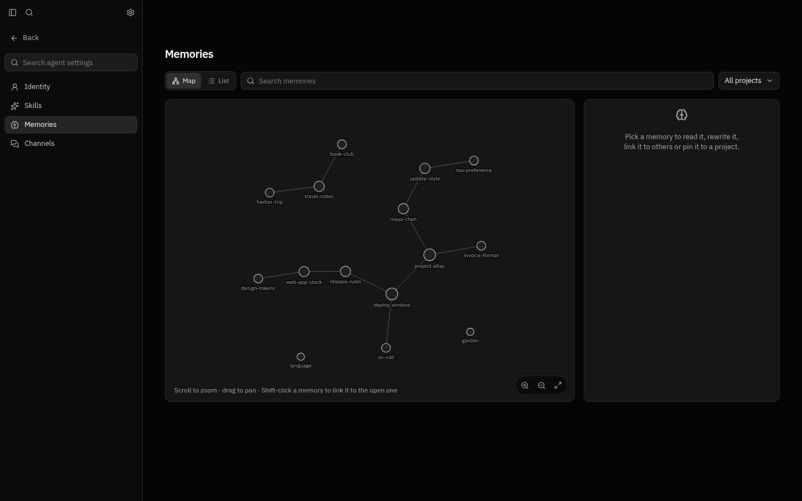

### Memories

* **Memories is a map:** Each memory is a dot, and each link between two memories is a line. Scroll to zoom and drag to move around, or use the zoom and **Fit the map** buttons in the corner. **List** shows the same memories as rows. Search narrows both, and **All projects** picks out what is pinned to one project.
* **Open a memory to change it:** The panel beside the map shows its text, which you can rewrite and save. **Recalled with** lists the memories linked to it, and **Link another memory** adds one. On the map, Shift-click a memory to link it to the open one, and Shift-click it again to unlink it. **Forget** still asks you to type `forget` first.
* **Pin a memory to a project:** Under **Projects**, pick the projects it belongs to. In a chat on one of them, the agent reads that memory before anything else, even when the message doesn't mention it. Outside those projects nothing changes. Only you can pin, so the agent writes a fact that belongs to one repository plainly and says which.

### Pages instead of overlays

* **Settings, agent settings and schedules take the chat's place:** They no longer float over the conversation. The sidebar becomes the page's list, with **Back** at the top, and the conversation waits underneath, as you left it. Escape goes back too. The Inspector stays away on these pages and comes back with the chat.
* **Every page is laid out the same way:** The title sits at the top, with what acts on the whole page (**Import**, **Create**, **Edit**) at its right. Search and filters go under it. Section titles, cards and text start on the same edge, so nothing sits a few pixels in. Pull requests keeps its own layout, since it's a table.
* **Agent settings starts with the search:** The agent's picture and name are no longer above it.

### Activity

* **Activity has its own place in the sidebar:** It moved out of agent settings and is now the last item in the sidebar, under Pull requests. It opens where the chat was, with no bar of its own.

### Skills

* **Skills are cards:** Search them by name, and filter by **All skills**, **Written here**, **Imported** or **Built-in**. A built-in skill has its switch on the card. One of the agent's own has a **⋯** menu with **Edit** and **Remove**. **Import** and **Create** are at the top.
* **A skill reads as Markdown:** Opening one shows its instructions formatted, with a back arrow, where it came from, and **Edit** or its switch.

### Pull requests

* **The table blends into the page:** It has no frame or rounded corners, just a line under the filters and one between pull requests. The first row has no second line on top. **Review** stays in one column whether or not a review chat exists.
* **Round buttons in the header:** **Refresh** and **Review settings** are round icon buttons, as in the other bars. The Inspector doesn't show on this page.

### Agents you follow in the Inspector

* **Clearer header:** The kind of agent, its tier and its model sit together in one row, on the same edge as the rest. **Stop** is a red button with its name, beside how long the agent has worked. The sides are less padded.

### Upgrading

* The desktop app updates itself to this release.
* **Servers:** Recreate the gateway and web containers with the 1.11.2 images, or follow the `latest` tags. Migration 0103 runs when the gateway starts.
* **API:** A memory has `projectIds`. `PUT /v1/profiles/{profileId}/memories/{memoryKey}/projects` takes `{ "projectIds": [...] }` and sets the projects it is pinned to.
