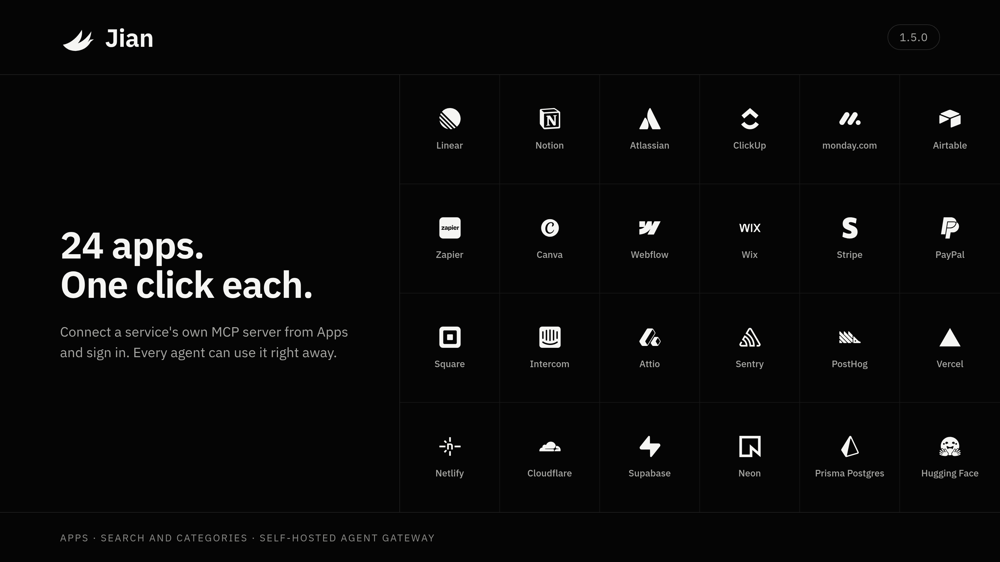

### Apps

* **Connect services in one click:** Linear, Notion, Atlassian (Jira and Confluence), ClickUp, monday.com, Airtable, Zapier, Canva, Webflow, Wix, Stripe, PayPal, Square, Intercom, Attio, Sentry, PostHog, Vercel, Netlify, Cloudflare, Supabase, Neon, Prisma Postgres and Hugging Face now each have a card. Connect adds the service's own MCP server and opens its sign-in, with no address or client ID to paste. Every agent can use it after that.
* **What a connected card shows:** Whether the service answers, checked again when you come back from the sign-in tab, a Sign in button when it asks for one, and Remove, which asks before deleting it. The card is the whole app: it stays off the MCP servers page, which keeps the servers you add by hand.
* **Nothing you added gets replaced:** A server you already added by hand at the same address shows up as that app, and moves from MCP servers to its card. If its name is taken, Connect saves the new one under another name.
* **Search and categories:** A search box looks through each app's name, category and description, and a category list next to it narrows the cards.

### Remote machines and the desktop browser

* **The desktop browser works with a server gateway:** An agent on a server gateway that tried to use the browser beside the conversation in your desktop app failed every time with "Mark did not answer". The app did the work, but its answer never reached the gateway. Now it does, screenshots included.
* **Updates refuse an old Node.js:** Updating Jian Remote on a machine with a Node.js older than 24 used to install the new release anyway, and then it broke on start. The update now stops before touching anything and tells you what to install.

### The panel

* **The Inspector opens when your agent asks:** `open_in_inspector` said it had worked, but the Inspector never opened and you had to open the pull request yourself. It opens now. The same fix stops the open conversation from reloading every time something happens in another one.
* **GitHub's real reason:** When GitHub refuses a merge or an Update branch, for example because of a ruleset, the message now says what GitHub said, instead of "Something changed, or the session is busy".
* **No sideways scrolling in settings:** A long name in a settings list, such as a schedule's, made the sidebar scroll sideways. Long names are now cut off with an ellipsis.

### Upgrading

* The desktop app updates itself to this release. The desktop browser fix is in the app, so it needs the new app.
* **Servers:** Recreate the gateway and web containers with the 1.5.0 images, or follow the `latest` tags. There is no migration.
* **Machines with Jian Remote:** Update them from Machines. A machine needs Node.js 24 or later. If one runs an older Node.js, install Node.js 24 on it, then run `npm install -g @jian-ai/remote-control@1.5.0 && jian-remote reinstall` there.
